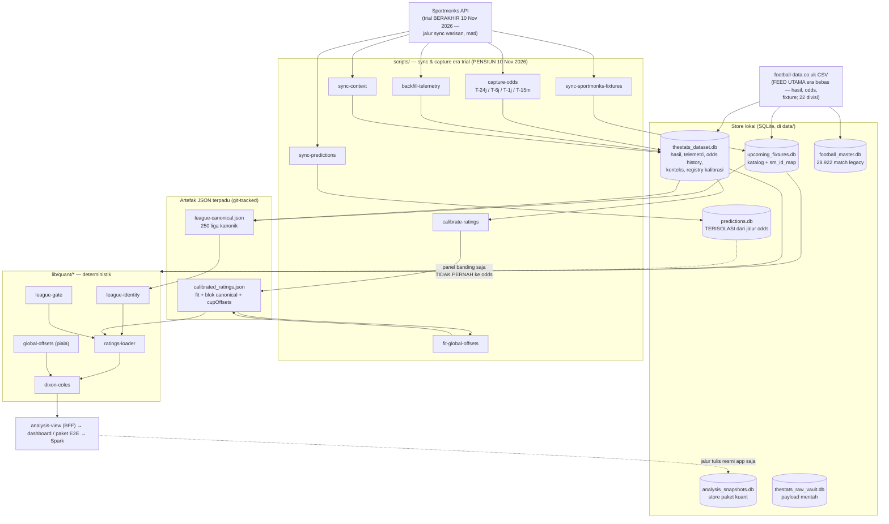

# ARCHITECTURE — Football Pre-Match Analyst Agent

> Ditulis ulang 4 Nov 2026 dari keadaan final sistem, sesudah lima fase
> berurutan: ekspansi database Sportmonks → overhaul backend → unifikasi
> liga kanonik → rekalibrasi domestik → kalibrasi piala (offset global).
> Semua angka di dokumen ini ditarik dari artefak di disk (laporan fase di
> `tasks/`, registry, dan store lokal) — bukan dari ingatan. Versi
> pra-sprint dokumen ini tergantikan seluruhnya; yang dipertahankan hanya
> bagian yang masih benar (aturan emas, bentuk pipeline planner/BFF,
> kontrak snapshot).
> Koreksi tujuan produk (5 Nov 2026, perintah owner): app ini bertujuan
> mencari **safe bet untuk parlay** — bukan melawan pasar, bukan
> berburu value bet tunggal. §1 ditulis ulang sesuai koreksi ini dan
> framing tujuan di seluruh dokumen disesuaikan; seluruh angka teknis
> tidak berubah.
>
> Sinkronisasi 19 Nov 2026 (dokumen ini acuan owner — diselaraskan ke
> keadaan live era bebas): jalur operasional utama kini **mode free** —
> feed football-data.co.uk + rantai `free-refresh` 12 jam 8 langkah
> (§8); trial Sportmonks **berakhir 10 Nov 2026** dan arsip
> predictions-nya panel banding saja, tidak pernah masuk jalur odds
> (§3, §7.2). Yang ikut diselaraskan: gerbang kalibrasi = **label,
> bukan pembatas** (INV-04 amendemen 18 Nov 2026 — §5.3, §9),
> resolver ter-wire sebagai langkah 8 rantai (16 Nov 2026 — §7.5, §8),
> ekspansi divisi fd 16 → 22 (16 Nov 2026 — §3.1, §3.4), segmentasi
> /bukti per `gate_status` (R-01), label gerbang per pilihan tiket
> (R-02), dan filter kembar mt_ di slate (R-03) — §7.5, §10. Angka
> yang disegarkan dibaca ulang langsung dari store (read-only) pada
> 19 Nov 2026 dan ditandai tanggalnya; angka lama yang dipertahankan
> tetap membawa tanggal ukurnya masing-masing. Basis audit:
> `tasks/reports/fase0-audit-jalur-data-report.md` (16 Nov 2026).

---

## 1. Tujuan & aturan emas

App ini menganalisis pertandingan sepak bola **sebelum kickoff** untuk
satu tujuan: **menemukan safe bet buat parlay** — outcome dengan
probabilitas kejadian tertinggi, yang layak dijadikan kaki parlay.
App ini **bukan** alat melawan pasar dan **bukan** pemburu value bet
tunggal: harga pasar tidak dilawan, melainkan dibaca sebagai salah
satu sumber taksiran probabilitas. Ukuran suksesnya adalah **hit-rate
dan kalibrasi pick berprobabilitas tinggi**, bukan edge atas pasar.
(Koreksi tujuan oleh owner, 5 Nov 2026 — framing value-bet warisan
desain awal app digantikan; angka backtest lama di laporan fase
`tasks/` adalah catatan sejarah, bukan tujuan saat ini.)

Konsekuensinya pada lapisan debat/verdict di bawah: pick diperingkat
dari **probabilitas model + kesepakatan lintas sumber** (model ×
konsensus pasar tanpa vig × panel Sportmonks) sebagai sinyal keamanan.
Di era bebas (pasca-10 Nov 2026) panel Sportmonks adalah arsip beku
bertanggal ≤7 Nov 2026; fixture tanpa panel menyepakati model × pasar
saja (mode `free`, §2) — ketiadaan panel dicatat jujur, tidak diisi
karangan.
Outcome yang sumber-sumbernya sepakat berprobabilitas tinggi = kaki
aman; outcome berprobabilitas rendah tetap bukan pick betapa pun besar
EV-nya. **EV/Kelly adalah catatan sekunder di paket — tidak pernah
menjadi gerbang keputusan.** Benchmark closing line (§5.4) tetap
dipertahankan sebagai **referensi akurasi probabilitas**: seberapa
dekat taksiran model dengan taksiran pasar paling matang — bukan
target "edge" yang harus dikalahkan.

**Aturan emas: semua angka datang dari code kuantitatif deterministik
di `lib/quant/*`. LLM hanya menyusun narasi dan keputusan alur — tidak
pernah menghitung atau mengarang angka.** Angka disalin apa adanya
sampai ke layar; field yang absen adalah `null` jujur, bukan 0 karangan.

Dua jalur lapisan debat/verdict di atas paket kuant:

1. **Sindikat 5-LLM (dorman, dipertahankan utuh).** Planner loop +
   debat Bull/Neutral/Bear → J1 → J2 di `lib/agent/*`,
   `lib/syndicate-orchestrator.ts`, `lib/llm/*` — file-file ini
   **READ-ONLY (🔒)** atas perintah owner, byte-identik dengan baseline,
   supaya bisa diaktifkan lagi kapan pun. Jalur ini saat ini tidak bisa
   jalan live: kredit NineRouter = 0 dan J2 (`muse-spark-1.3-contributor`)
   cenderung membalas kosong (verdict UNANIMOUS by-construction).
2. **Spark sebagai lapisan debat (jalur aktif).** Paket kuant dibangun
   offline lewat driver E2E (§7.3), lalu Spark sendiri yang membaca
   paketnya, menyusun debat, dan memberi verdict. Angka tetap hanya dari
   code; Spark tidak pernah mengarang figur.

Guard deterministik di luar jangkauan LLM mana pun:
`lib/quant/fallback-guard.ts` — pick yang sisinya bersumber `fallback`
hanya lolos bila margin probabilitas model atas konsensus pasar >50%
(ambang code yang sudah terdaftar); kalau tidak, pick itu gugur.
Gerbang kalibrasi (§5.3) menandai liga yang belum terbukti — dan
sejak keputusan owner 5 Nov 2026 label itu **bukan pembatas**: pick
dari liga uncalibrated tetap terbit, dengan `gate_status`-nya terbawa
sampai ke tiket dan /bukti (INV-04, diamendemen 18 Nov 2026; §5.3).

---

## 2. Gambaran pipeline

> **Keadaan final (7 Nov 2026, pasca-cleanup pra-deploy; disegarkan
> 19 Nov 2026 untuk era bebas).** Ada dua jalur:
>
> **(A) Jalur saji AKTIF — frontend v2 + mesin pick.** Halaman adalah
> Server Component yang membaca store lokal langsung lewat
> `lib/web/data.ts` (koneksi read-only; tanpa API route di tengah):
> `/` (landing + statistik ledger), `/pertandingan` (daftar laga dari
> paket terbaru per fixture), `/pertandingan/[matchId]` (detail paket:
> probabilitas 3 sumber, λ/μ, matriks skor, form kanonik),
> `/pilihan` (pick live-run ber-grade dari ledger, tiap pilihan
> berlabel gerbangnya — R-02), `/bukti` (kejujuran
> grade: promised vs actual, per grade & per pasar, **tersegmentasi
> per `gate_status`** sejak R-01, 17 Nov 2026). Paket kuant
> dihasilkan `scripts/pick-slate.ts` → disimpan sebagai paket versi di
> `analysis_snapshots.db` (`packages`) → pick diterbitkan ke ledger
> `data/picks.db` oleh `lib/picks/engine.ts` dan dinilai hasilnya oleh
> `scripts/resolve-pick-outcomes.ts` — yang sejak 16 Nov 2026 adalah
> **langkah 8 rantai free-refresh** (§8), bukan lagi panggilan lepas.
> Jalur tulis yang menghidupkan jalur saji ini sekarang adalah rantai
> mode free itu; jalur sync Sportmonks pada diagram jalur (B) adalah
> warisan era trial (berakhir 10 Nov 2026), dipertahankan sebagai
> penjelasan asal-usul data yang tersimpan. Setiap paket membawa
> `feed_mode`: `full` (panel Sportmonks ikut) atau `free` (tanpa SM —
> kesepakatan = model × pasar saja, `sm_prob` NULL jujur).
>
> **(B) Jalur planner/sindikat — DORMAN (diagram di bawah).** Shell HTTP
> `app/api/agent` + planner 🔒 + debat 5-LLM tetap utuh atas aturan
> owner, tapi frontend v2 tidak memanggilnya; rute API warisan
> (`agent`, `betting`, `matches`, `odds`) adalah permukaan HTTP lama
> tanpa auth — utang deploy A2: diputuskan di langkah deploy (hapus
> rute atau gating reverse proxy), bukan di cleanup ini.

```
User buka dashboard (app/page.tsx) ──► GET /api/matches?hours=12|24|48|72   [katalog, offline dari store]
User klik match ──► GET /api/agent?match_id=...                              [analisis]
                     │
                     ▼
        app/api/agent/route.tsx  (shell HTTP: validasi + merge)
                     │
                     ▼
        lib/agent/planner.ts :: runPlannerAnalysis()  🔒
        loop plan→act→evaluate→re-plan, hard cap 8 step
                     │
   ┌─────────────────┼──────────────────────────────────────┐
   ▼                 ▼                                      ▼
 [1] check_data_integrity ─► lib/stats-fetcher-agent.ts + lib/stats-validator.ts
   │     jalur offline: baris fixture + anchor odds lokal → Zod → VerifiedMatchIntelligence
   │     (pertandingan.kompetisi = STRING NAMA saja — lihat kompromi identitas §4.4)
   ▼
 [2] fetch_missing_intel (hanya bila evaluator code menemukan gap; maks 1×)
   ▼
 [3] run_quant_package ─► lib/quant/* (100% code) — detail §5 (liga) & §6 (piala)
   │     resolusi liga kanonik → parameter shrunk (prior ratings + blend telemetri)
   │     → Dixon-Coles → Shin vig-strip → probabilitas + EV (sekunder, §1) → konteks (konteks TIDAK
   │     mengubah probabilitas) → merge wire Sportmonks (odds/lineup/predictions
   │     berlabel sumber; predictions TIDAK pernah masuk jalur odds)
   ▼
 [4] run_syndicate_debate 🔒 (dorman) ── atau ── Spark membaca paket (jalur aktif)
   ▼
 [5] run_editorial_analysis 🔒 ─► JSON editorial closed-world
   ▼
 [6] stop_with_verdict
   │
   ▼
 lib/view/analysis-view.ts :: mapPipelineToView()          ← BFF
   pure function, Zod AnalysisViewSchema, angka disalin 1:1,
   fallback-guard + status gerbang kalibrasi merambat ke view
   │
   ▼
 response JSON: { match, ringkasan, kuantitatif, odds, debat, thinking, markets,
                  data_quality, fallback_guard, calibration_gate }
   │
   ▼
 dashboard 4 tab: Ringkasan · Kuantitatif · Odds · Debat
```

Setiap tool mengembalikan `coverage_check` hasil evaluator **code**
(`lib/agent/coverage.ts`), bukan self-report LLM; itulah satu-satunya
dasar re-plan yang sah (trigger: `FIELD_KOSONG`, `CONSENSUS_LEMAH`,
`ODDS_DISLOCATION` |EV| > 20%).

---

## 3. Lapisan data

### 3.1 Diagram alur data



Sejak 10 Nov 2026 rantai tulis yang benar-benar berjalan adalah
`free-refresh` (§8): importer fd menulis hasil + telemetri + odds ke
`thestats_dataset.db` dan fixture ke `upcoming_fixtures.db`; subgraph
SYNC di atas adalah rantai era trial yang sudah pensiun —
dipertahankan di diagram karena ia menjelaskan asal-usul baris era SM
di store. Cakupan feed fd: **22 divisi** sejak ekspansi 16 Nov 2026
(16 warisan + E2/E3/EC/SC1/SC2/SC3; status gerbang divisi baru: E2
partial, lima lainnya calibrated — gerbang yang sama, tidak
dilonggarkan). Kesegaran hasil fd dibatasi ritme publikasi situs itu
sendiri (Selasa/Jumat): ekor hasil fd di store mencapai laga
16 Nov 2026 per bacaan 19 Nov 2026.

### 3.2 Store SQLite (angka audit 4–7 Nov 2026, disegarkan 19 Nov 2026)

Semua store di `data/`, semua **gitignored** (data runtime; bisa dibangun
ulang dari API; pengecualian satu-satunya adalah arsip legacy beku di
`archive/`). Prinsip pemisahan file: **berdasarkan
fungsi saja** — bukan berdasarkan sumber atau benua (lihat §3.4).
Sel "Baris saat ini" di tabel bawah memuat angka audit 4–7 Nov 2026;
angka segar hasil bacaan read-only 19 Nov 2026 dicantumkan dalam
kurung bertanggal sesudahnya — angka lama tidak ditimpa diam-diam.

| Store | Isi kunci | Baris saat ini | Catatan |
|---|---|---|---|
| `upcoming_fixtures.db` | `upcoming_fixtures` (katalog), `competition_catalog` (317), `sm_id_map` (fixture SM → match katalog) | 3.770 fixture; 3.420 peta (19 Nov 2026: 3.924 fixture) | Disposable; horizon katalog beku di maks 2027-01-05 (era SM); fixture baru kini hanya dari feed fd |
| `thestats_dataset.db` (±3,0 GB per 7 Nov 2026; ukuran file 3,0 GB terverifikasi 19 Nov 2026) | `matches` (hasil), `team_match_logs` (telemetri per tim per laga), `teams`, `match_odds_history`, `league_calibration` (registry), `standings`, `expected_lineups`, `prematch_news`, `h2h_cache`, `team_squads` | matches 70.114; team_match_logs 85.521 (83.098 Sportmonks); teams 6.450; match_odds_history 4.071; standings 1.308 (69 liga); expected_lineups 620 (310 fixture); prematch_news 18; h2h_cache 610 (19 Nov 2026: matches 71.503; team_match_logs 88.299; teams 6.541; match_odds_history 8.426 — NULL 500 · sportmonks 4.091 · football-data 3.835; registry league_calibration 131 baris) | Store kerja utama; semua baris berlabel sumber; skor/statistik absen = NULL, tidak pernah dikarang |
| `football_master.db` | `matches` historis football-data.co.uk (16 divisi legacy) | 28.922 (tetap — terverifikasi 19 Nov 2026) | Prior historis fit legacy |
| `predictions.db` | `sm_predictions` (nilai probabilitas per fixture), `sm_value_bets`, `sm_predictability` | 70.553 nilai; 80 value bets; 5.590 predictability (86 liga) (19 Nov 2026: 84.721 nilai — tangkapan terakhir 7 Nov 2026, 924 fixture per audit Fase 0; beku by design sebagai panel arsip) | **TERISOLASI — aturan keras: predictions tidak pernah masuk `match_odds_history` / jalur odds kuant.** Hanya tampil sebagai panel banding berlabel di view |
| `analysis_snapshots.db` | `packages` (paket kuant per run: payload lengkap + provenance + cap waktu input), `meta` | 78 paket (audit 5 Nov 2026); 3.802 paket (audit 7 Nov 2026); 6.806 paket (19 Nov 2026) | **Store paket kuant** — sejak 5 Nov 2026 menggantikan snapshot legacy atas keputusan owner (ADR-003); 21 baris legacy diarsipkan utuh ke `archive/analysis_snapshots-legacy-2026-10.db`. Satu baris per fixture per versi run; dirujuk pick ledger lewat `package_id`. Detail: `docs/DATABASE.md` §6 |
| `picks.db` | `picks` (ledger pick lab + live-run), `pick_outcomes` (resolusi skor akhir) | 167.273 pick / 163.008 outcome (audit 7 Nov 2026) (19 Nov 2026: 169.942 pick = lab 163.008 + live-run 6.934; 164.329 outcome; live-run ter-resolve 1.321) | **Ledger pick** — sumber halaman `/pilihan` & `/bukti`; indeks parsial unik `idx_picks_live_unique` mencegah pick live ganda (perbaikan A1) |

Baris yang dihapus dari tabel ini: `thestats_raw_vault.db` — dihapus
pada cleanup pra-deploy 7 Nov 2026 (batch B2) bersama modul pembacanya
yang sudah mati; payload mentah era TheStats tidak lagi disimpan.

Ruang ID per sumber: match `mt_*` (TheStats) / `sm_<fixtureId>`
(Sportmonks); kompetisi `comp_*` / `sm:<leagueId>`; tim `tm_*` / angka
mentah SM sebagai string. Jembatan: `sm_id_map` (baris `mt_` yang sudah
ada selalu menang atas pembuatan kembaran `sm_`), `teams` (nama → id),
dan — sejak fase kanonik — registry identitas di §4. ⚠️ Nama tim tidak
unik: 9 grup nama persis dan 12 grup ternormalisasi dipakai >1 team_id
(di tabel `teams`, terukur audit 5 Nov 2026); lintas sumber, 111 grup
ejaan berbeda menunjuk tim yang sama, dan 26 grup kunci ganda ada di
dalam satu liga ratings yang sama (salinan alias berstatistik
identik — mis. Bournemouth/AFC Bournemouth di E0 dan SM8) — tim
sempat tidak punya registry kanonik seperti liga (proposal P-05 di
laporan audit); **kini sudah punya**: `data/team-canonical.json`
(§3.4 — 6.600 entri per 19 Nov 2026), dibangun ulang tiap refresh
dan menjadi acuan identitas tim lintas sumber;
resolusi nama→ID wajib sadar konteks liga (sudah diterapkan di loader +
resolver telemetri bersama: log terbanyak menang, seri → id terkecil).

### 3.3 Odds — `match_odds_history`

4.071 tangkapan: 500 legacy (anchor TheStats, `source` NULL) + 3.571
Sportmonks, terdiri dari 3.383 `baseline` (tangkapan pertama fixture) +
188 `scheduled` (titik jadwal). (Terukur audit 5 Nov 2026.) Payload disimpan tersaring ke market
utama (payload mentah penuh bisa ±2,3 MB/fixture). Fixture tanpa odds
terbit dicatat `has_odds = 0` — jujur kosong, bukan hilang. Backfill
premium history = **0 baris**: semua endpoint `/odds/premium*`
mengembalikan data kosong pada probe berulang meski entitlement
tercatat; mekanisme `capture_kind='backfill'` siap bila endpoint hidup.
Per 19 Nov 2026 total tangkapan **8.426**: 500 legacy (NULL) + 4.091
Sportmonks (beku ≤7 Nov 2026) + **3.835 football-data** (`closing` +
`fd-prematch` dari importer mode free — satu-satunya sumber odds yang
masih tumbuh).

### 3.4 Artefak JSON terpadu (git-tracked)

- **`data/league-canonical.json`** — registry identitas liga (§4).
  Dihasilkan `scripts/build-league-canonical.ts` dari store lokal.
  (250 entri — terverifikasi tetap 19 Nov 2026; diregenerasi pada
  ekspansi divisi 16 Nov 2026.)
- **`data/calibrated_ratings.json`** — output fit: **72 entri liga /
  1.842 tim** (56 kunci SM + 16 divisi legacy; status registry hasil
  join kanonik, terukur audit 5 Nov 2026: kunci SM 28 calibrated /
  28 partial, divisi legacy 11 calibrated / 5 partial), setiap entri
  membawa `canonicalId`, plus blok metadata
  `canonical` (registry + versi + `generated_at`) dan blok
  `canonical.cupOffsets` (model piala, §6). Dihasilkan
  `scripts/calibrate-ratings.ts`; blok `cupOffsets` ditanam
  `scripts/fit-global-offsets.ts` tepat sesudahnya dalam rantai
  free-refresh (langkah 5, tepat sesudah calibrate di langkah 4 —
  urutan kontraktual, §8). (19 Nov 2026: **84 entri liga / 2.088 tim**
  — compile terakhir 18 Nov 2026 dari rantai free-refresh; sensus
  status di file: 32 calibrated / 35 partial / 1 uncalibrated /
  16 tanpa status — ke-16-nya fit warisan beku 11–14 Okt, §10 R-04.)
- **`data/team-canonical.json`** — registry identitas tim (pasangan
  §4 untuk tim): **6.600 entri** (19 Nov 2026), dibangun ulang tiap
  refresh (`build-team-canonical`, langkah 2) dari semua store;
  merge alias dieksekusi di sini (mis. Celta B = Celta Fortuna,
  16 Nov 2026).
- **`data/fixture-links.json`** — peta kembar fixture lintas sumber
  (twin_id ↔ canonical_id): 188 tautan (19 Nov 2026), dibangun ulang
  tiap refresh (langkah 3); dikonsumsi resolver (jembatan skor
  kembar) dan filter slate R-03 (§7.5).

**Prinsip file terpadu** (keputusan owner, 4 Nov 2026): satu sumber
kebenaran per jenis data. Graf benua model piala adalah **data di dalam
artefak yang sama** (field per liga), bukan file per benua — memecah
file akan menciptakan masalah routing baru persis seperti yang baru
dibereskan di §4. DB SQLite terpisah hanya berdasarkan fungsi/siklus
hidup (katalog disposable vs store paket terversi vs predictions
terisolasi).

---

## 4. Identitas liga kanonik

### 4.1 Masalahnya

Nama/ID liga tiba dari **4 konvensi berbeda**: Sportmonks `sm:<leagueId>`
(nama polos + negara kolom terpisah), TheStats `comp_*` (nama polos,
ejaan sendiri), divisi legacy football-data (`E0`, `SP1`, … dengan nama
berawalan negara seperti "English Premier League"), dan kunci ratings
(campuran kode legacy + `SM<leagueId>`). Di katalog: 88 id kompetisi
tetapi hanya 73 nama — "Premier League" sendirian menunjuk 6 id dari
5 negara. Resolusi berbasis string nama terbukti menyajikan fit yang
salah (fixture Premier League Sportmonks dilayani ratings legacy E0;
803 dari 3.770 fixture — 21,3% — berubah fit pelayannya setelah
perbaikan).

### 4.2 Registry

`data/league-canonical.json`: **250 entri kanonik** (satu per liga
dunia-nyata), **412/412 identitas sumber terpetakan (100%)** —
sportmonks 109, thestats 208, legacy-div 22 (16 divisi + 6 `master_*`),
ratings-key 73; 0 tak terpetakan.

- **Identitas = `canonical_id`**: `sm:<leagueId>` bila liga ada di
  Sportmonks (identitas primer era SM — dipertahankan sebagai id
  kanonik walau feed-nya sudah berakhir); selain itu kode divisi
  legacy; selain itu id TheStats `comp_*`.
- **Referensi = `name` + `country`** sebagai pasangan (negara kolom
  sendiri) — nama polos sendirian tidak pernah jadi kunci.
- Setiap entri memuat `aliases` (semua identitas sumber + `name_as_stored`
  versi tiap store) dan `fits` (fit ratings per sistem + statusnya dari
  registry `league_calibration`, sumber kebenaran status).
- Penggabungan lintas sistem: join eksak atas (nama ternormalisasi +
  negara); yang lolos dari join diputuskan eksplisit di `FORCE_MERGE`
  berkomentar di generator — tidak ada fuzzy matching diam-diam. Ke-16
  liga legacy tergabung ke padanan Sportmonks-nya. 31 entri `comp_*`
  TheStats tidak punya negara di katalog sumber (NULL) → entri kanonik
  sendiri, belum bisa digabung secara bertanggung jawab (keputusan
  owner terbuka, §10).

### 4.3 Resolusi & aturan fit yang melayani

Satu-satunya tempat logika identitas: `lib/quant/league-identity.ts`
(`resolveServingForMatch`, `getCanonicalBySourceId`,
`getCanonicalByNameCountry`, …), dikonsumsi `ratings-loader.ts` lewat
`resolveMatchLeague()`; hasil resolusi selalu tercatat di
`metadata.leagueResolution` paket kuant (kanonik, sistem fit, jalur,
alasan).

Urutan resolusi:

1. **ID sumber** → entri kanonik → fit.
2. **Baris fixture tersimpan** (pemulihan ID — lihat §4.4).
3. **Nama + negara**.
4. **Nama polos** hanya bila tepat satu entri cocok; beberapa kandidat →
   saring keanggotaan kedua tim di fit kandidat; **tetap ambigu → null
   eksplisit** (tidak ada lagi peminjaman divisi legacy diam-diam).
   String yang sama sekali tak dikenal registry jatuh ke jalur warisan
   bernama eksplisit (`legacy-fallback`) sebagai jaring pengaman untuk
   singkatan feed eksternal.

**Aturan fit yang melayani:** fit yang sistemnya sama dengan sumber
fixture (fixture `sm:` → fit Sportmonks; fixture legacy/TheStats → fit
legacy); entri ber-fit tunggal → fit itu; sumber tak diketahui + dua fit
memuat kedua tim → fit Sportmonks (warisan era trial, kini beku).
Konsekuensi gerbang yang
disadari: untuk 5 liga dual-fit yang fit SM-nya partial sementara fit
legacy-nya calibrated (Championship, Bundesliga, La Liga 2, Eredivisie,
Pro League Belgia), gerbang kini melaporkan status kanonik **partial** —
flag jujur di tingkat liga; penyajian fit legacy sendiri tidak diblokir.

### 4.4 Kompromi batas intel (🔒)

`VerifiedMatchIntelligence.pertandingan` hanya membawa string nama —
meneruskan `competition_id` menembusnya butuh edit skema/planner 🔒.
Jalur non-🔒 yang dipakai: loader memulihkan ID dari baris
`upcoming_fixtures` dengan pasangan nama kandang/tamu persis + kompetisi
yang cocok ke entri kanonik yang sama. Konsekuensi terukur: 80 pasangan
pertandingan terdaftar sebagai **kembaran mt_/sm_** (laga sama, kickoff
identik, dijembatani `sm_id_map`); untuk kembaran ID `sm:` yang menang
(id kanonik katalog; baris mt_ hanya jembatan identitas), jadi
kedua baris dilayani fit yang sama. Peta kembar yang lebih luas kini
hidup di `data/fixture-links.json` (§3.4): audit Fase 0 (16 Nov 2026)
menghitung 177 grup duplikat / 188 baris tertaut di katalog — peta
inilah yang sejak R-03 (18 Nov 2026) menyaring kembar mt_ di slate
(§7.5). Kesetiaan per-baris untuk kembaran
hanya bisa dicapai dengan meneruskan `match_id` — pekerjaan 🔒, terbuka
sebagai keputusan owner (§10).

---

## 5. Model domestik (liga)

### 5.1 Fit

Per liga, dari hasil + telemetri di store (3 jendela musim, time-decay):

- **IPF attack/defense** per tim: λ_home = leagueAvgGoals × att_home ×
  def_away × homeAdvantage; leagueAvgGoals = rata-rata gol away
  terbobot; bobot decay **half-life 365 hari** (diuji {180, 365, 730, ∞}
  di walk-forward — 365 bertahan, semua alternatif dalam ±0,002).
- **Shrinkage fit κ=10** (log-space) — perbaikan terbesar Fase 3:
  tanpa shrinkage, komponen weakly-connected meledak (Danish 1.
  Division terfit attack 16,38 / defense 0,01). Held-out Level A:
  log-loss 1,0503 → **1,0298**; tier OTHER 1,1781 → 0,9980.
- **rho Dixon-Coles = 0** untuk liga SM — hasil negatif berbasis bukti:
  varian rho {0, global, fitted} berbeda ≤0,0006 log-loss di validasi
  dan rho fitted justru terburuk pada 1X2. Rho legacy (−0,12…+0,02)
  dipertahankan apa adanya.
- Hyperparameter **tidak di-tuning ulang** di rekalibrasi — rekalibrasi
  adalah penerapan ulang protokol yang sama di atas struktur kanonik
  dan data yang tumbuh, bukan re-optimisasi.

### 5.2 Parameter runtime (jalur analisis)

- Prior ratings dari `calibrated_ratings.json`, lalu **blend telemetri
  James-Stein**: w = n/(n+κ), window rolling **6 laga** anti-leakage
  (hanya laga sebelum cutoff), xG dipakai bila ≥3 sampel xG. κ blend
  **×2 dari asumsi lama → 16 (xG) / 28 (gol) / 32 (tanpa telemetri)** —
  terpilih di validasi dan terkonfirmasi held-out (Level B 1,0340 →
  **1,0205**; slope kalibrasi 0,631 → 0,953). κ×3 sengaja tidak diuji
  (disiplin anti garden-of-forking-paths).
- `calculateDixonColes`: matriks Poisson 11×11 × koreksi τ(rho) di
  (0,0),(0,1),(1,0),(1,1), dinormalisasi Σ=1 → 1X2, fair odds, O/U,
  BTTS, AH, clean sheet, xPts, top scorelines.
- `stripVigShin` (Shin, bisection z ∈ [0, 0,4]) atas odds pasar nyata →
  konsensus tanpa vig. Konsensus ini dibaca sebagai **sinyal
  kesepakatan** dengan probabilitas model (§1), dan perbandingan pasar
  hanya berjalan dari odds pasar nyata — tanpa odds pasar, market itu
  tidak punya pembanding.
- `evaluateValueBet` + `evaluatePortfolioKelly` tetap dihitung engine:
  EV + quarter-Kelly, cap per bet 4,0%, cap portofolio per match 5,0%
  (parameter risiko owner, bukan statistik; sizing tidak menciptakan
  edge). Sesuai §1, keluaran ini **informasi sekunder di paket** —
  bukan penentu pick.
- Konteks yang **dilarang mengubah probabilitas**: momentum,
  half-profile, luck-regression (metadata/label saja, ambang heuristik
  eksplisit).
- Normalisasi xG lintas kompetisi kini **terukur dari store**
  (`dataset.matches`), menggantikan konstanta tulisan tangan + default
  diam-diam 1,48 dari era lama.
- Roster fit mencakup semua tim yang muncul di jendela data; alias
  bentuk-nama fixture ("AFC Bournemouth" → "Bournemouth") dijembatani
  konservatif di skrip kalibrasi. Konsumsi terverifikasi atas 3.770
  fixture: kedua tim ketemu **2.982**, satu sisi 15, nol 19; kompetisi
  ter-cover penuh **58/88**.

### 5.3 Tiga gerbang kalibrasi (registry `league_calibration`)

Status per liga diputuskan berurutan; tidak ada liga tersaji diam-diam:

1. **Uji skala ≤2% (ketat)** — Σλ fit vs Σ gol aktual. Sengaja ketat:
   ke-36 partial era sprint semuanya gagal di sini pada cakupan 100%
   (artefak metrik tak-terbobot vs fit terbobot-waktu, tercatat jujur).
   **Tidak dilonggarkan** — melonggarkan = keputusan owner.
2. **Cakupan telemetri musim berjalan ≥80%.**
3. **Gerbang OOS walk-forward** — fit harus mengalahkan baseline naive
   pada lipatan held-out yang tidak pernah dipakai tuning (lantai
   sampel n≥20): calibrated gagal OOS → partial; partial gagal OOS →
   uncalibrated (status terendah di registry — konsekuensi
   penyajiannya diatur paragraf berikut, bukan diuji di sini).

Penyajian menurut status: `calibrated` = normal; `partial` = tersaji +
flag eksplisit yang merambat sampai view (`calibration_gate`);
`uncalibrated` = di jalur planner/driver (§7.1–7.3) diblokir dengan
alasan eksplisit. **Untuk jalur live-run (slate → ledger → tiket),
keputusan owner 5 Nov 2026 berlaku: gerbang adalah label, bukan
pembatas** — liga uncalibrated tetap di-rate slate, pick-nya terbit
membawa `gate_status`, dan label itu wajib tampil di konsumen:
statistik /bukti tersegmentasi per status (R-01, 17 Nov 2026) dan
setiap pilihan tiket berlabel gerbangnya (R-02, 18 Nov 2026).
Kontraknya tertulis di INV-04 `docs/DATA-INVARIANTS.md` (diamendemen
18 Nov 2026; rumusan lama "uncalibrated ⇒ tidak ada kaki live"
dinyatakan superseded). Uji penentu status di atas **tidak berubah
dan tidak dilonggarkan** — yang berubah adalah konsumsi statusnya,
bukan ambangnya. Gerbang dibaca
`lib/quant/league-gate.ts` dari **status kanonik**: divisi apa pun
di-resolve ke entri kanoniknya dulu, lalu baris `league_id =
canonical_id` yang dibaca. Registry kini 125 baris, kolom
`canonical_id` terisi 125/125.

**Status saat ini (4 Nov 2026):**

| Basis | Calibrated | Partial | Uncalibrated |
|---|---|---|---|
| Kanonik — 83 liga pembawa fixture/fit (rekalibrasi) | **28** | **29** | **26** |
| Registry 125 baris (query langsung) | 44 (28 SM + 16 legacy) | 32 (28 liga + 4 piala via `source='cup-offset'`) | 49 (36 liga + 13 piala) |

**Status segar (audit Fase 0, 16 Nov 2026; terverifikasi ulang
19 Nov 2026):** registry kini **131 baris — 48 calibrated / 39 partial
/ 44 uncalibrated** (menurut sumber fit: sportmonks-fit 92,
legacy-csv-fit 22 — kini 22 divisi fd, cup-offset 17). Di file
`calibrated_ratings.json` (compile 18 Nov 2026): 84 fit / 2.088 tim;
16 fit warisan tanpa `calibrationStatus` adalah fit beku 11–14 Okt
(R-04, §10).

Rekalibrasi kanonik menghasilkan tepat **satu perubahan status final**:
`sm:1085` AFC Champions League Elite calibrated → partial (held-out
1,0841 vs naive 1,0758, n=43 — item pengawasan "margin tipis" Fase 3
yang buktinya berbalik di data yang tumbuh; statusnya kemudian
digantikan perlakuan piala di §6). Championship dan Liga Portugal 2
kini lolos uji skala tetapi tetap partial karena gerbang OOS menahan.

### 5.4 Bukti out-of-sample & benchmark closing line

Walk-forward (63 liga ≥120 match, 44.231 match; lipatan validasi untuk
seleksi, lipatan held-out final tidak pernah dipakai tuning), hasil
rekalibrasi — stabil vs Fase 3:

| Metrik held-out | Nilai |
|---|---|
| Level A (ratings murni) — baseline produksi lama | LL 1,0509 |
| Level A — konfigurasi teradopsi | **LL 1,0295** (naive 1,0736) |
| Level B (jalur produksi penuh, κ blend ×2) | **LL 1,0202** |

**Benchmark closing line — terukur pertama kali** (sebelumnya n=0):
30 match bertangkapan odds pre-kickoff yang sudah selesai; subset
berpasangan n=21 — model LL **0,9575** vs closing LL **0,8668**.
Probabilitas model masih kurang akurat dari closing pada sampel
pertama yang kecil ini. Kesimpulan yang didukung bukti: model
mengalahkan baseline naive dan terkalibrasi baik secara OOS. Sesuai
§1, benchmark ini adalah **referensi akurasi probabilitas** — closing
adalah taksiran pasar paling matang, jadi selisih log-loss ke closing
mengukur jarak taksiran model dari taksiran terbaik yang tersedia;
bukan target "edge" yang dikejar.

**Pembaruan 9 Nov 2026 (re-run point-in-time, leakage dibersihkan —
`tasks/oos-rerun-pointintime-2026-11-09.md`):** angka tabel di atas
berasal dari run 4 Nov yang oleh laporan re-run itu dinyatakan masih
mengandung leakage; dipertahankan di sini sebagai catatan bertanggal.
Re-run bersih (n held-out 6.317): Level A winner (kfit:20) **LL
1,0179**; Level B winner (κ blend ×2 — konfigurasi produksi) **LL
1,0092**. Produksi Level A masih memakai kfit:10; pergeseran winner
ke kfit:20 (margin validasi 0,0026) adalah keputusan owner yang
terbuka (§10).

**Benchmark closing skala besar (16 Nov 2026, metode dikunci sebelum
run — `tasks/closing-benchmark-report.md`):** menggantikan sampel
kecil di atas: 1X2 pooled **n=1.223**, LL model 1,0090 vs closing
Pinnacle murni 0,9769 → **Δ +0,0320** (model masih di belakang
closing; tidak ada edge — konsisten dengan §1: closing adalah
referensi akurasi, bukan target).

---

## 6. Model piala — offset global per graf benua

### 6.1 Kenapa piala tidak di-fit sebagai liga

Model §5 mengasumsikan kompetisi tertutup (semua tim saling bertemu,
satu skala). Piala melanggarnya tiga arah: tim datang dari ±30 liga
dengan skala gol dan level kekuatan berbeda (att/def domestik tidak
sebanding lintas liga), sampel per tim tipis (±8 laga/musim di format
baru UCL), dan dinamika knockout berbeda (leg kedua dipengaruhi
agregat; final di venue netral). Karena itu kompetisi piala **tidak
pernah di-fit per-liga** — sebelum fase ini mereka `uncalibrated`
by design, dengan satu pengecualian warisan (jalur pseudo-UCL, §6.5)
yang kini pensiun.

### 6.2 Desain: satu δ per liga, di-fit dari laga lintas-liga

Fondasi tetap fit domestik pasca-rekalibrasi (att/def terkunci ke
parameter shrunk yang dikonsumsi jalur kuant). Di atasnya, per **graf
benua** di-fit satu **offset kekuatan δ per liga domestik** (skala log)
dengan maximum-likelihood Poisson atas **semua laga lintas-liga di
store** — kompetisi kontinental graf itu + piala domestik lintas
divisi — dengan decay half-life 365 hari dan ridge L2 lemah (1,0):

```
λ_home = G × HA_cup × att_home × e^{δ_Lhome} × def_away × e^{−δ_Laway}
μ_away = G × att_away × e^{δ_Laway} × def_home × e^{−δ_Lhome}
```

δ hanya teridentifikasi sebagai selisih → satu liga referensi per graf
di-clamp δ=0 (liga dengan laga jangkar terbanyak). Ikut di-fit per
graf: rata-rata gol global **G** dan home advantage piala **HA_cup**.
Penyajian fixture piala: att\* = att × e^δ, def\* = def ÷ e^δ, basis G
graf, HA piala graf (venue netral → HA = 1), rho = 0, lewat mesin
Dixon-Coles yang sama — **formula penyajian = formula yang divalidasi
walk-forward, persis**. Tim debutan tidak buta: ia mewarisi δ liganya.
Liga tanpa laga jangkar: δ tidak teridentifikasi (null) — tidak
ditebak, fixture-nya ter-flag.

Penyimpanan **terpadu** (bukan file per benua): `cup_model` +
`cup_offset` sebagai field di entri registry kanonik
(`league-canonical.json`) + blok `canonical.cupOffsets` di
`calibrated_ratings.json` (metadata graf + status 17 kompetisi).
162 entri kanonik membawa record `cup_offset`; **47 liga
teridentifikasi**: Eropa 33, CONMEBOL 6, AFC 8.

Implementasi: inti fit offline `lib/quant/cup-offset-fit.ts`; harness
validasi `scripts/backtest-cup-offsets.ts` (→ `tasks/cup-oos.json`);
fit produksi + tulis artefak `scripts/fit-global-offsets.ts`;
penyajian runtime `lib/quant/global-offsets.ts`, dipanggil
`ratings-loader.ts` bila kompetisi fixture adalah piala tercakup
`cup_model`. **v1 jujur:** parameter tim = fit domestik murni (prior
makro) **tanpa blend telemetri last-6** — tercatat
`metadata.telemetrySource = 'macro_prior_only'` di paket. Leg-2
knockout diperlakukan laga biasa di v1 (divalidasi terpisah, §6.4).
Status kompetisi dibaca dari registry lewat league-gate: uncalibrated
diblokir pemanggil sebelum modul penyajian dipanggil; partial tersaji
dengan flag `calibrationStatus` di metadata `cupOffset` paket.

### 6.3 Hasil fit produksi (4 Nov 2026)

| Graf | Referensi (δ=0) | G | HA piala | Jangkar | Liga teridentifikasi |
|---|---|---|---|---|---|
| Eropa | sm:8 Premier League | 1,2588 | 1,289 | 1.857 | 33 |
| CONMEBOL | sm:648 Brasileirão Série A | 0,8468 | 1,4164 | 512 | 6 |
| AFC | sm:944 Saudi Pro League | 1,1714 | 1,2401 | 226 | 8 |

Urutan δ waras secara sepakbola. Eropa: La Liga −0,09 (terkuat di bawah
referensi) · Bundesliga −0,16 · Ligue 1 −0,19 · Serie A −0,24 ·
Eredivisie −0,49 · Championship −0,56 … terlemah First League Bulgaria
−0,95 dan National League (tier-5 Inggris) −1,00; divisi dua menempel
di bawah divisi utamanya (La Liga 2 −0,25, Ligue 2 −0,38, Serie B
−0,62). CONMEBOL: Argentina −0,08 · Uruguay −0,25 · Kolombia −0,30.
AFC: J1 League **+0,09** — satu-satunya liga di atas referensinya;
Indian Super League −0,34 tetapi **tipis: hanya 2 jangkar** (δ rapuh,
tercatat apa adanya).

### 6.4 Gerbang piala & status yang diraih (pradaftar, tidak dilonggarkan)

Protokol walk-forward per kompetisi: fit domestik + δ hanya dari data
sebelum musim uji (fit domestik di-fit ulang per lipatan — tanpa
kebocoran parameter produksi); naive = base rate kandang/tandang
kompetisi itu sendiri pada laga yang sama-sama ter-rate (paired).
Gerbang ditetapkan di header `scripts/backtest-cup-offsets.ts` SEBELUM
hasil dilihat: **calibrated** = n≥100 ∧ cakupan ≥0,80 ∧ LL<naive ∧
slope ∈ [0,70; 1,30]; **partial** = n≥30 ∧ cakupan ≥0,50 ∧ LL<naive;
selain itu uncalibrated.

Hasil atas 17 kompetisi dalam scope: **0 calibrated · 4 partial · 13
uncalibrated**. Status tertulis sebagai 17 baris `source='cup-offset'`
di registry + `cup_model` per entri kanonik.

| Kompetisi | Uji n | Cak. | LL model | LL naive | Slope | Status — alasan |
|---|---|---|---|---|---|---|
| sm:2 Champions League | 415 | 0,57 | 0,9825 | 1,0399 | 1,121 | **partial** |
| sm:5 Europa League | 383 | 0,69 | 0,9912 | 1,0455 | 1,022 | **partial** |
| sm:27 Carabao Cup | 141 | 0,96 | 0,8074 | 0,9741 | 1,470 | **partial** (slope di luar band) |
| sm:390 Coppa Italia | 56 | 0,77 | 0,7042 | 0,7584 | 1,557 | **partial** |
| sm:2286 Europa Conference League | 647 | 0,29 | 0,9956 | 1,0788 | 0,890 | uncalibrated — cakupan |
| sm:24 FA Cup | 1.534 | 0,05 | 0,8511 | 0,9689 | 1,182 | uncalibrated — cakupan |
| sm:307 Coupe de France | 150 | 0,15 | 0,9625 | 1,1028 | 1,096 | uncalibrated — cakupan |
| sm:468 Taça de Portugal | 212 | 0,08 | 0,9548 | 1,0043 | 1,176 | uncalibrated — cakupan |
| sm:570 Copa del Rey | 154 | 0,19 | 1,0107 | 1,0353 | 0,965 | uncalibrated — cakupan |
| sm:654 Copa do Brasil | 214 | 0,39 | 0,9744 | 1,0818 | 1,015 | uncalibrated — cakupan |
| sm:109 DFB Pokal | 90 | 0,49 | 0,7724 | 0,9632 | 2,278 | uncalibrated — cakupan 0,49 < 0,50 (near-miss; aturan tetap aturan) |
| sm:1088 AFC CL Two | 169 | 0,08 | 0,8422 | 1,1112 | 1,396 | uncalibrated — cakupan |
| sm:950 Kings Cup | 37 | 0,51 | 0,6587 | 0,9402 | 3,153 | uncalibrated — n<30 ter-rate |
| sm:1085 AFC CL Elite | 174 | 0,48 | 1,0109 | 1,0501 | 0,760 | uncalibrated — cakupan 0,48 < 0,50 |
| sm:78 KNVB Beker | 150 | 0,21 | 1,0957 | 0,9418 | 0,504 | uncalibrated — **kalah dari naive** |
| sm:1122 Copa Libertadores | 288 | 0,40 | 1,0885 | 1,0690 | 0,564 | uncalibrated — **kalah dari naive** |
| sm:1116 Copa Sudamericana | 290 | 0,46 | 1,1012 | 1,0771 | 0,463 | uncalibrated — **kalah dari naive** |

Taksonomi kegagalan (bukti, bukan tebakan):

- **Cakupan** (mayoritas): cakupan diukur atas seluruh laga historis
  kompetisi termasuk babak kualifikasi — tim dari liga di luar katalog
  109 liga Sportmonks tidak punya fit domestik (diagnosis fold UCL
  2026/2027: 99 dari 106 slot tim tak-ter-rate = "tidak ada liga
  domestik di store"). Batas struktural store, bukan bug resolver.
  Mengubah definisi cakupan = mengubah gerbang pradaftar → keputusan
  owner (§10).
- **Kalah dari naive** (KNVB; kedua kompetisi CONMEBOL): slope ≈ 0,5 =
  overconfidence lintas-liga — ekstrem att/def domestik diterapkan
  hampir tanpa redaman pada jangkar latih yang tipis. Urutan δ sendiri
  waras dan code yang sama sehat di Eropa → bukan bug arah. Varian
  kompresi/temperatur adalah varian model baru — tidak di-tune di
  held-out; keputusan owner (§10).
- **Leg-2**: di subset leg-2 UCL/UEL/UECL model tetap mengalahkan
  naive (UCL leg-2 LL 1,0011 vs 1,0303; UEL 0,9494 vs 0,9957; UECL
  0,8780 vs 1,0317) — perlakuan leg-2 sebagai laga biasa tidak terbukti
  merusak di v1.

Konsekuensi penyajian saat ini (dari `verify-consumption`, 3.770
fixture): jalur offset **142 fixture ter-rate penuh, 359 terblokir
gerbang uncalibrated, 29 tim tak ter-resolve** — UCL 48/54 dan UEL
43/54 ter-rate ber-flag partial; UECL 0/72 dan ACL Elite 0/36 terblokir
sesuai status yang mereka raih (fallback teranotasi tanpa angka, bukan
probabilitas karangan).

### 6.5 Pensiun jalur pseudo-UCL

Jalur lama — divisi semu "UCL" (parameter hardcoded avg 2,04 / HA 1,12
/ rho −0,05) + penskalaan √Q koefisien UEFA tulisan tangan
(`findTeamRatingForUCL`, `UEFA_LEAGUE_COEFFICIENT`) — **dihapus**.
Muara 'UCL' dari fallback warisan ditolak eksplisit; `loader_special`
hilang dari seluruh registry. Kompetisi piala yang gagal gerbang
dilayani flagged/diblokir lewat jalur offset — tidak pernah diam-diam
lewat pseudo.

### 6.6 Konektivitas & lubang bernama

- **Eropa (33 liga):** lubang bernama — **sm:486 Russia Premier
  League** (klub Rusia dibekukan dari kompetisi UEFA sejak 2022 → nol
  laga lintas-liga di store; lubang nyata yang bisa dijelaskan);
  **sm:211 Challenger Pro League** (piala Belgia tidak ada di store
  Sportmonks → nol jangkar); **sm:14 League Two, sm:274 Danish 1.
  Division, sm:603 Turkish 1. Lig** (punya baris registry tetapi tidak
  punya entri fit sama sekali → tidak ada yang bisa ditransformasi).
  Tipis: sm:465 Liga Portugal 2 (29 jangkar), sm:292 Veikkausliiga
  (34), sm:304 Ligue 2 (36).
- **CONMEBOL (6 liga):** 0 lubang di antara liga ber-fit; liga
  Paraguay/Ekuador/Peru/Venezuela/Bolivia hanya ada di ruang TheStats
  tanpa fit SM.
- **AFC (8 liga, graf paling tipis — 226 jangkar):** sm:1007 Indian
  Super League teridentifikasi dari 2 jangkar saja; sm:1356 A-League
  dan sm:1073 V-League tidak teridentifikasi.
- **Copa del Rey (sm:570)** — lubang bernama: status uncalibrated
  (cakupan 0,19, §6.4) karena mayoritas tim pesertanya dari divisi
  bawah Spanyol yang tidak punya fit domestik maupun δ — fixture
  mereka tidak ter-rate oleh jalur offset, dan tidak ada angka yang
  dikarang sebagai gantinya. Contoh live: CD Badajoz vs Tenerife
  (katalog `sm_19893321`, kickoff 19 Nov 2026) — Badajoz di luar
  graf, jadi laga ini tidak punya rating yang bisa disajikan.
- Di luar graf secara desain: **CAF tidak dibangun** (enumerasi saja —
  sm:1107 CAF Champions League, 378 hasil, saat ini tetap ter-fit
  sebagai liga biasa berstatus partial; keputusan owner, §10);
  sm:1452 Intercontinental Cup = lintas benua, diparkir sebagai batas
  graf yang diketahui; sm:1419 UEFA Women's Champions League tidak
  diberi `cup_model` (hanya 3/369 laga yang kedua timnya ber-fit) dan
  dilindungi guard tabrakan nama agar resolusi "Champions League" tidak
  menyentuh entri wanita; friendlies dikecualikan sebagai bukan
  kompetisi bermakna untuk offset.

---

## 7. Jalur analisis operasional

### 7.1 Hop inti (yang benar-benar mengeksekusi angka)

1. **Intel** — `fetchAndValidateMatchIntelligence` (`stats-fetcher-agent`
   + `stats-validator`): jalur offline membangun intel dari baris
   fixture tersimpan + anchor odds lokal; Zod men-sanitasi jadi
   `VerifiedMatchIntelligence` dengan `missing_data_registry` yang
   jujur. Parser odds validator berbentuk TheStats — payload SM mentah
   tidak ter-parse di sini; odds SM masuk lewat wire (hop 3).
2. **Telemetri** — `lib/db/team-telemetry.ts`: rolling 6 laga per tim
   dari `team_match_logs` (match_date < cutoff, anti-leakage), agregat
   null-jujur (xG/npxg/shots hanya dari baris NOT NULL; data absen =
   sampel mengecil, bukan 0).
3. **Wire Sportmonks** — `lib/odds/sportmonks-wire.ts`
   (`mergeSmDetailIntoIntel`, `pickSmQuotes`: bookmaker utama id 35 =
   1xBet, pembanding id 20 = Pinnacle) + `sportmonks-adapter.ts`.
   **Jalur render tidak memanggil API** — detail dibaca dari store
   lokal; semua merge berlabel sumber. Predictions SM hanya masuk panel
   banding `sm_predictions` di view (isolasi §3.2).
4. **Paket kuant** — `buildQuantPackage` (planner 🔒) memanggil
   `lib/quant/*`: resolusi kanonik → `getShrunkMatchParameters` →
   Dixon-Coles → Shin → probabilitas + EV (sekunder, §1) → konteks. Metadata resolusi liga,
   status gerbang, dan (untuk piala) `cupOffset` lengkap (graf, kedua
   liga + δ, fit asal, G, HA, netral) tercatat di paket.
5. **View** — `mapPipelineToView()`: pure function; angka disalin 1:1;
   konversi tampilan hanya lewat helper sadar-skala; fallback-guard dan
   `calibration_gate` merambat ke view. Frontend = dumb renderer
   (kontrak `AnalysisViewSchema`: match, ringkasan, kuantitatif, odds,
   debat, thinking, markets + `data_quality`, `fallback_guard`,
   `calibration_gate`; `is_strictly_grounded` adalah marker jujur yang
   wajib tampil).

### 7.2 Sumber yang sudah mati / beku

- **TheStatsAPI mati permanen** 18 Okt 2026 (`403 KEY_REVOKED`).
  Modul fetcher era itu (`lib/stats-fetch.ts` + rantai vault/budget)
  dihapus pada cleanup 7 Nov 2026 (batch B1, 0 referensi terverifikasi);
  tidak ada panggilan API di jalur render.
- **Sportmonks Pro trial berakhir 10 Nov 2026.** Sesudah itu semua
  jalur tulis berhenti di batas data 3–10 Nov; store lokal tetap utuh
  dan terbaca offline.

### 7.3 Driver E2E (jalur aktif Spark)

- `scripts/run-one-analysis.ts` — satu analisis liga domestik end-to-end
  offline: seleksi fixture berkriteria (liga calibrated, kedua tim
  ber-fit, odds + predictions ada) → intel → paket kuant planner 🔒 apa
  adanya → paket JSON di `tasks/`. Penerimaan kanonik: Everton vs
  Coventry (sm_19722110) — run #1 (fit E0, artefak routing) H 49,15 /
  D 27,93 / A 22,92 → run #2/#3 (fit SM8 kanonik) **H 47,22 / D 25,27 /
  A 27,52** (λ/μ 1,552/1,123), identik pasca-rekalibrasi.
- `scripts/run-one-cup-analysis.ts` — padanannya untuk piala (seleksi
  programatik fixture UCL ter-rate jalur offset). Penerimaan:
  **Fenerbahçe vs Liverpool** (sm_19872622) — Fenerbahçe dari fit SM600
  (δ Turki −0,4792), Liverpool dari fit SM8 (δ 0, referensi), G 1,2588,
  HA 1,289 → **H 25,82% / D 21,10% / A 53,08%**, status kompetisi
  `partial` terbawa sebagai flag di metadata.
- Kedua driver: nol panggilan API, nol tulis ke snapshots, nol
  modifikasi file 🔒. Verdict ditulis Spark di chat dari paket — belum
  ada jalur persistensi verdict ke snapshots di luar insert produksi
  app (keputusan terpisah, fase frontend).
- Quirk yang diketahui: graf modul planner 🔒 melempar error saat import
  headless tanpa env NineRouter (throw di scope modul
  `syndicate-orchestrator` → `lib/llm/models.ts`); driver memuat env
  dari `.env.local` (dengan key API dikosongkan paksa) sebagai
  workaround. Perbaikan akar menyentuh file 🔒 → keputusan owner.

### 7.4 Kesegaran harga — caveat yang masih terbuka

Perbandingan pasar di paket berjalan terhadap tangkapan odds terbaru
di `match_odds_history` **tanpa aturan kesegaran**: tangkapan
`baseline` berumur beberapa hari ikut diperlakukan seolah harga live.
Pada E2E run #1, dua angka EV nominal (Draw +16,2%, Coventry +13,0%)
bertumpu pada harga berumur 4 hari — dan setelah perbaikan routing,
EV Draw runtuh ke +5,1% karena probabilitas modelnya yang berubah.
Sampai aturan kesegaran ditanam (mis. perbandingan hanya memakai
tangkapan ≤ jendela T-24j, sisanya ber-flag `stale`), lapisan verdict
wajib memperlakukan sinyal kesepakatan berbasis harga tua sebagai
tidak andal dan mengompensasi manual. Ini gap desain yang diakui,
belum ditutup.

Catatan kualitas data lain dari run E2E: `form_split` intel bisa
ber-sampel 0/0 tetapi rata-rata golnya terisi (inkonsistensi builder
offline); validator H2H tidak selalu sinkron dengan `h2h_cache`.

### 7.5 Jalur slate live-run (mesin pick — jalur operasional era bebas)

Inilah jalur yang benar-benar menghasilkan pick sejak ritme SM
berakhir; ia berjalan sebagai langkah 7–8 rantai free-refresh (§8):

1. **Scan slate** — `scripts/pick-slate.ts` memindai katalog 72 jam
   ke depan. **Filter kembar mt_ (R-03, commit `079787c`, 18 Nov
   2026):** fixture `mt_` yang punya kembar kanonik di
   `fixture-links.json` dilewati sebelum rating (paket/pick hanya
   lahir dari baris kanonik) — menutup pengulangan dobel era trial
   4–8 Nov (438 paket + 422 pick mt_, audit Fase 0 §6). Fixture mt_
   tanpa kembar tetap di-rate normal.
2. **Paket + pick** — tiap fixture ter-rate menjadi paket versi di
   `analysis_snapshots.db` dengan provenance lengkap (`feed_mode`,
   `fit_source`, `gate_status`, stempel odds/panel), lalu
   `lib/picks/engine.ts` menerbitkan pick ke ledger. Gerbang di sini
   adalah label: `applyGateCap` pass-through by design (INV-04);
   `gate_status` tertulis di paket dan di baris pick.
3. **Resolver (langkah 8)** — `scripts/resolve-pick-outcomes.ts`
   menilai pick dari skor final lokal: exact match_id → jembatan
   `sm_id_map` → jembatan kembar `fixture-links` (jalur terakhir
   ditambahkan 16 Nov 2026, commit `09da4fe`, bersama wiring-nya ke
   free-refresh; regresi sebelumnya: resolver tak terpanggil sejak
   cron era trial dihapus 10 Nov, sehingga outcome membeku di 7 Nov
   selama 9 hari). Skor tak ketemu = tetap unresolved, tidak
   ditebak: per 19 Nov 2026, **1.321 pick live-run ter-resolve**;
   sisa lampau terbesar adalah kompetisi tanpa sumber hasil gratis
   (2.104 pick per audit Fase 0 — FA Cup, Liga BetPlay, MLS, WSL,
   Brasileirão, dst.), yang tidak akan pernah bisa dinilai ledger
   dengan sumber saat ini.
4. **Konsumsi** — /bukti membaca ledger langsung per request dan
   sejak R-01 menyajikan rekor tersegmentasi per `gate_status`;
   output tiket (contoh parlay slate + slip /pilihan) sejak R-02
   membawa label gerbang per pilihan.

---

## 8. Ritme harian & jadwal tangkapan

Satu entrypoint era trial: `scripts/daily-refresh.ts` (**pensiun
10 Nov 2026** bersama trial; diuraikan di bawah sebagai catatan era
itu) — semua langkah idempoten
(menjalankan dua kali berturut: diff baris = 0 kecuali tangkapan
terjadwal yang sah baru jatuh tempo):

```
1. catalog     sync-sportmonks-fixtures   horizon bergulir 60 hari
2. odds        capture-odds               tangkapan jatuh tempo (lihat jadwal)
3. predictions sync-predictions --days=14 skip segar 20 jam
4. telemetry   backfill-telemetry --current-only
5. calibrate   calibrate-ratings          refit dari store; menulis blok canonical
6. cup-offsets fit-global-offsets         menanam blok cupOffsets + status baris piala
                                          (TEPAT sesudah calibrate — urutan ini kontraktual:
                                          calibrate menulis ulang blok canonical tiap siklus)
7. context     sync-context               standings, berita, lineup, H2H ≤7 hari
8. laporan     → tasks/coverage-latest.md
```

**Jadwal tangkapan odds** (per fixture, `scripts/capture-odds.ts`):
baseline saat fixture masuk katalog, lalu titik terjadwal
**T-24j, T-6j, T-1j, T-15m** sebelum kickoff (T-15m = proksi closing
line untuk benchmark §5.4). Titik yang terlewat tidak bisa
direkonstruksi setelah kickoff — perishable, karenanya ritme tidak
boleh putus selama jendela trial. Predictions membusuk ±20 jam;
expected lineups makin lengkap ≤24 jam sebelum kickoff.

**Otomasi:** cron `football-daily-refresh-trial` menjalankan rantai ini
**tiap 6 jam s/d 10 Nov 2026** (Asia/Jakarta; diam bila sukses, melapor
bila gagal), token hanya lewat env di konfigurasi job (persetujuan
owner). Job penutup sekali-jalan **10 Nov 2026 09:00 WIB** menghapus
jadwalnya dan melaporkan ringkasan penutup jendela + kesiapan benchmark
closing line. Token mati bersama trial — sesudah 10 Nov tidak ada run
yang berguna dijalankan.

**Ritme yang bertahan — dan kini satu-satunya ritme (mode free,
tanpa token):** `scripts/free-refresh.ts` — rantai **8 langkah** yang
mengambil alih setelah trial berakhir: (1) `import-free-feed` (hasil
+ odds closing + telemetri + fixture football-data.co.uk),
(2) `build-team-canonical`, (3) `build-fixture-links`,
(4) `calibrate-ratings`, (5) `fit-global-offsets`,
(6) `build-canonical-telemetry`, (7) `pick-slate --hours 72`,
(8) `resolve-pick-outcomes` (ditambahkan 16 Nov 2026 — sebelumnya
rantai berhenti di langkah 7 dan outcome membeku sejak 7 Nov, §7.5).
Satu langkah exit non-nol → rantai berhenti dan run cron gagal
terlihat (tidak senyap). Dijalankan cron `football-free-refresh`
**tiap 12 jam (05:21 & 17:21 WITA)** di VM ini — sehat: run 16–18 Nov
2026 semua langkah exit 0 (tercatat di commit refresh git). Paket
yang terbit di mode ini ber-`feed_mode='free'` (lihat §2).

**Status VPS (per 19 Nov 2026):** salinan rantai yang sama berjalan
via crontab di VPS, tetapi rantainya **mati di langkah 6
(`build-canonical-telemetry`) — Node heap OOM, exit 134**: langkah
itu memuat tabel form kanonik sekaligus (±86 ribu baris, ±1,9 GB)
sementara RAM VPS hanya 3,7 GB berbagi dengan app + Caddy + 9Router.
Akibatnya langkah slate tidak pernah jalan di sana dan **pick di
situs live beku sejak 9 Nov 2026**; impor + kalibrasi di VPS tetap
berjalan, dan app-nya sendiri sehat (empat rute publik — `/`,
`/pertandingan`, `/pilihan`, `/bukti` — terverifikasi 200 pada
19 Nov 2026). Di VM (RAM 7,7 GB) langkah yang sama lolos — karena
itu angka ledger acuan adalah angka VM. Obat permanen yang
direkomendasikan: telemetri diproses per chunk (bukan dimuat
sekaligus); alternatifnya memindahkan hitungan ke VPS baru 16 GB.
**Keputusan owner — belum dieksekusi** (§10).

> Catatan keadaan saat dokumen ini ditulis (4 Nov 2026): satu run
> rantai-LAMA (dimulai sebelum fase piala mengubah `daily-refresh.ts`)
> masih berjalan di langkah telemetry-nya. Sesuai desain rantai, run
> itu akan menulis ulang baris piala + blok JSON sekali saat tiba di
> langkah calibrate-nya (tanpa langkah cup-offsets), dan run BERIKUTNYA
> (rantai baru) memulihkannya. Artefak ter-commit saat ini
> (`calibrated_ratings.json` + registry per commit `7b28b11`) sudah
> memuat seluruh hasil fase piala — konvergensi dijamin oleh rantai,
> bukan intervensi manual.

---

## 9. Guardrails (jangan dilanggar)

1. **Angka hanya dari code** — `lib/quant/*` tidak memanggil LLM; LLM
   tidak menghitung angka.
2. **Fidelitas angka sampai ke layar** — view-model menyalin apa
   adanya; helper tampilan sadar skala; field absen → `null` / "—".
3. **Predictions terisolasi** — tidak ada jalur dari `predictions.db`
   ke `match_odds_history` / jalur odds kuant; panel banding berlabel saja.
4. **Store paket menggantikan snapshots** — sejak keputusan owner
   5 Nov 2026 (ADR-003), `data/analysis_snapshots.db` adalah store
   paket kuant (satu baris per fixture per versi run, dirujuk ledger
   lewat `package_id`); disiplin append-only era lama tidak berlaku
   lagi untuk file ini, dan 21 baris legacy-nya beku di arsip
   `archive/analysis_snapshots-legacy-2026-10.db` (INV-16).
5. **Gerbang tidak dilonggarkan diam-diam** — toleransi skala 2%,
   definisi cakupan gerbang piala, dan ambang OOS adalah pradaftar;
   mengubahnya = keputusan owner tercatat.
6. **Status jujur selalu tersaji** — partial ber-flag; uncalibrated
   terblokir dengan alasan di jalur planner/driver, dan di jalur
   live-run terbit sebagai pick **berlabel** `gate_status` yang wajib
   tampil di konsumen (INV-04 amendemen 18 Nov 2026); tidak ada
   liga/kompetisi yang tersaji diam-diam di bawah statusnya.
7. **Anti-leakage fail-closed** — telemetri/form/H2H lokal terikat
   cutoff waktu; `utc_date` absen → sumber dilewati total.
8. **Perbandingan pasar hanya dari odds pasar nyata** (dan lihat
   caveat kesegaran §7.4).
9. **File 🔒 tidak disentuh** — planner, llm, schemas, coverage,
   syndicate-orchestrator, `lib/llm/*`, `lib/db/analysis-snapshot.ts`
   (kode dorman; `data/analysis_snapshots.db` bukan lagi 🔒 sejak
   ADR-003). Hash baseline:
   `tasks/backend-readonly-hashes.txt` (terverifikasi 8/8 di setiap
   fase).
10. **Tidak ada panggilan API di jalur render** — semua baca dari store
    lokal.

---

## 10. Keputusan owner yang terbuka & utang terukur

**Ditutup sejak 7 Nov 2026 (pernah terbuka/bermasalah, kini selesai):**

- **Resolver ter-wire ke free-refresh** (16 Nov 2026, commit
  `09da4fe`) — outcome live-run hidup lagi; backfill +297 saat
  perbaikan, 1.289 ter-resolve hari itu juga (§7.5).
- **Ekspansi divisi fd 16 → 22** (16 Nov 2026) — E3/EC/SC1/SC2/SC3
  calibrated, E2 partial; gerbang tidak dilonggarkan (§3.1, §3.4).
- **R-01 segmentasi /bukti per `gate_status`** (17 Nov 2026, commit
  `2de80db`) — headline grade A tidak lagi mencampur segmen
  (A calibrated 83,6% / partial 83,1% / uncalibrated 71,4% saat R-01
  diukur terhadap query SQL langsung).
- **R-02 label gerbang per pilihan tiket + amendemen INV-04**
  (18 Nov 2026, commit `8db6f70`) — kontrak gerbang = label kini
  tertulis dan cocok dengan perilaku kode (§5.3).
- **R-03 filter kembar mt_ di slate** (18 Nov 2026, commit `079787c`)
  — mendarat ±30 jam sebelum jendela mt_ 20 Nov (§7.5).
- **Rumah kode + backup** — repo GitHub
  `hyperrrdice-arch/BOLA-ARANDISUPERR` menjadi rumah kode sejak
  16 Nov 2026 (riwayat Oktober terarsip di branch
  `arsip-versi-oktober`); backup data mingguan ke VPS berjalan
  (script `~/workspace/football-backup/`, cron Senin dini hari WIB).

Belum diputuskan (diparkir eksplisit oleh fase-fase sebelumnya; tidak
diselesaikan sepihak):

1. **Scope CAF** — graf keempat (CAF Champions League + liga CAF di
   store) belum dibangun; sm:1107 masih diperlakukan liga biasa
   (partial, skala 0,6025 — deteksi piala berbasis nama tidak
   menangkapnya).
2. **Definisi cakupan gerbang piala** — diukur atas seluruh laga
   historis termasuk kualifikasi. Diukur atas populasi babak utama
   saja, UECL dan ACL Elite kemungkinan lolos partial.
3. **Varian kompresi lintas-liga CONMEBOL** (temperatur pada att/def
   atau δ) — butuh protokol validasi sendiri; tidak di-tune di
   held-out yang ada.
4. **Konsekuensi blokir sm:1085 ACL Elite** — 36 fixture upcoming-nya
   kini terblokir di jalur offset (fallback teranotasi tanpa angka),
   atau ACL diperlakukan pengecualian.
5. **Klaim EV special markets** — audit merekomendasikan dinonaktifkan:
   Brier 0,30 vs base rate 0,25 = tanpa skill terukur (engine-nya
   sendiri tetap berjalan sebagai konteks). Sesudah koreksi tujuan
   5 Nov (§1), urgensi item ini turun: EV bukan lagi gerbang keputusan
   di mana pun di sistem — yang tersisa adalah keputusan higienis soal
   label klaim di engine konteks ini.
6. **Diskon promosi ×0,85/×1,20** — masih hidup di fallback
   lintas-divisi loader untuk kasus non-piala, **belum teruji**
   (harness menilai fit per-liga, bukan jalur pinjam). Untuk fixture
   piala, jalur offset menggantikan perannya.
7. **Aturan kembaran mt_/sm_** (§4.4) dan **default sumber-tak-dikenal
   condong SM**.
8. **31 identitas TheStats tanpa negara** (§4.2) dan **jembatan akronim
   Belanda** (PEC/ADO/NEC — sisa cakupan comp_3809; himpunan imbuhan
   jembatan nama sengaja tidak diperluas sepihak).
9. **Aturan kesegaran harga** untuk perbandingan pasar (§7.4).
10. **kfit:10 vs kfit:20 (Level A)** — re-run OOS point-in-time
    9 Nov 2026: winner validasi bergeser ke kfit:20 (margin 0,0026
    LL); produksi masih kfit:10. Menaikkannya mengubah angka
    produksi → keputusan owner (§5.4).
11. **Perbaikan rantai refresh VPS** — telemetri OOM di VPS (§8):
    chunking telemetri (obat permanen yang direkomendasikan) vs
    memindahkan hitungan ke VPS baru 16 GB. Selama belum diputuskan,
    pick situs live beku sejak 9 Nov 2026; ledger VM adalah acuan.
12. **Token football-data.org** — importer suplemen fixture sudah
    jadi dan dorman (`scripts/import-fdorg-fixtures.ts`); menunggu
    owner mendaftar token gratis. Nilai tambahnya terkecil di daftar
    ini (12 kompetisi, tanpa odds, skor tertunda).
13. **R-04: fit-ulang 16 fit warisan** — 16 fit legacy (E0, SP1,
    SP2, D1, dst.) beku di vintage 11–14 Okt 2026 dan — lewat aturan
    fit-sesuai-sumber — melayani fixture fd_ di liga-liga besar
    (selisih μ terukur 0,28 pada satu laga fisik, audit Fase 0
    Trace A). Jalur fit-ulang atau pengalihan ke fit SM segar adalah
    pekerjaan berikutnya di daftar Fase 0, menunggu aba-aba owner.

Utang operasional yang diketahui: kredit NineRouter = 0 (jalur verdict
in-app mati; Spark adalah jalur aktif), J2 sering membalas kosong,
cache snapshot tanpa single-flight, dan benchmark closing line
sampel kecil yang sudah digantikan benchmark skala besar 16 Nov 2026
(n=1.223, §5.4).

Addendum cleanup pra-deploy (7 Nov 2026; laporan:
`tasks/pre-deploy-cleanup-report-2026-11-07.md`): temuan audit lama
yang DITUTUP — A4 (ESLint hidup lagi, `eslint-config-next ^16`),
A5 (4 npm script mati dihapus), A6 (`getH2HLogs` dihapus), A13 (19 file
`components/dashboard/` mati dihapus; tersisa `types.ts` yang terikat
keputusan A2). Yang SENGAJA dibiarkan: A2 (rute API warisan —
keputusan langkah deploy), A3 (optimasi `SELECT *` telemetri dicoba
dan di-revert: fase tulis mendominasi, bukan pola baca — lihat
laporan), A7/A14 (duplikasi predikat/tepi pita — butuh uji kesetaraan
dulu), A8–A12 (minor robustness/satuan — antrean terpisah). Performa
saji diperbaiki di `lib/web/data.ts`: cache `landingStats` bertanda
tangan file + COUNT upcoming tanpa parse, dan cache fixture di
`ledgerStats().recent` (median `/` 2,05s → 1,59s, `/bukti` 1,68s →
1,52s; teks render identik).

---

## Lampiran — peta bukti

| Klaim di dokumen ini | Artefak sumber |
|---|---|
| Sprint ekspansi DB (katalog, odds, predictions, telemetri, konteks) | `tasks/sprint-report-2026-11-09.md`, `tasks/tier-table.json`, `tasks/mapping-review.md` |
| Alur backend per hop + titik asumsi lama | `tasks/backend-flow-map.md` |
| Audit model + vonis Fase 3 | `tasks/model-audit.md`, `tasks/oos-results.json`, `tasks/oos-gate.json` |
| Unifikasi kanonik (250/412, 803 fixture berubah) | `tasks/league-canonical-report.md`, `data/league-canonical.json` |
| Rekalibrasi (satu demosi, closing n=30) | `tasks/recalibration-report.md` |
| Model piala (δ, gerbang, status 0/4/13) | `tasks/cup-offset-report.md`, `tasks/cup-oos.json` |
| Cakupan harian terakhir | `tasks/coverage-latest.md` (dibangkitkan tiap run ritme) |
| Paket penerimaan E2E | `tasks/e2e-run-1-package.json` (+ `.pre-canonical` / `.canonical`), `tasks/e2e-cup-package.json` |
| Re-run OOS point-in-time + keputusan kfit | `tasks/oos-rerun-pointintime-2026-11-09.md`, `tasks/oos-results.json` |
| Benchmark closing skala besar (Δ +0,0320 @ n=1.223) | `tasks/closing-benchmark-report.md`, `tasks/closing-benchmark.json` |
| Mode free (importer fd, feed_mode, importer fdorg dorman) | `tasks/free-mode-report.md`, `tasks/free-feed-research.md` |
| Ekspansi divisi fd 16 → 22 | `tasks/free-divisions-expansion-report.md` |
| Audit jalur data era bebas + daftar R-01…R-10 | `tasks/reports/fase0-audit-jalur-data-report.md` |
| Resolver ter-wire (langkah 8) + backfill 297 | `tasks/reports/resolver-wiring-report.md`, commit `09da4fe` |
| R-01 / R-02 / R-03 | commit `2de80db` / `8db6f70` / `079787c`; kontrak INV-04 di `docs/DATA-INVARIANTS.md` |
