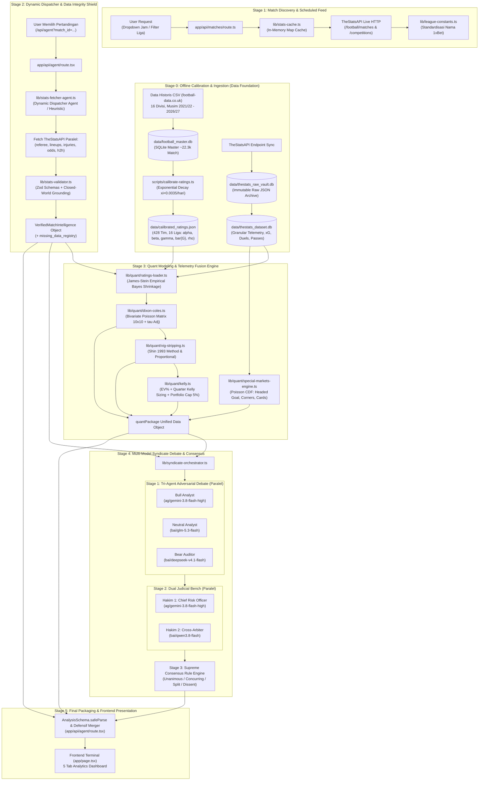

# Arsitektur Sistem — Football Agent Syndicate

**Versi Dokumentasi:** 1.4.0  
**Basis Codebase:** Commit `3fd6774` (Update Terkini: Multi-League Telemetry Ingestion, Telemetry Fusion, & Special Markets Engine)  
**Tipe Aplikasi:** Next.js 16 (App Router, Turbopack, React 19) — Sports Analytics & Quantitative Syndicate Terminal  

---

## 1. Filosofi Arsitektur & Prinsip Utama

Sistem ini dibangun atas prinsip **Closed-World Grounding (Zero Hallucination Directive)** dengan pemisahan mutlak antara **Engine Deterministik** dan **Orkestrasi AI Naratif**:

1. **Determinisme Angka (Zero Math Hallucination)**:
   Semua kalkulasi angka peluang murni, xG, vig margin, expected value (+EV), stake sizing Kelly, probabilitas pasar khusus (headed goal, corners, cards), dan shrinkage parameter dihitung 100% oleh kode matematis murni (TypeScript). LLM **tidak pernah** diminta menghitung peluang atau rumus matematika.
2. **LLM Sebagai Adversarial Auditor & Qualitative Synthesizer**:
   Peran model bahasa (LLM) dibatasi secara ketat untuk:
   - Mengevaluasi dinamika kualitatif (benturan taktik, kelelahan, berita cedera resmi).
   - Menjalankan debat segitiga multi-model (*Bull Analyst*, *Neutral Auditor*, *Bear Risk Officer*).
   - Menyintesis vonis komite (*Dual Judicial Bench*) untuk menentukan keyakinan (*confidence tier*) dan menyaring *trap lines* bandar.
3. **Multi-Tier Persistence Architecture**:
   Sistem mengombinasikan data historis makro (22.394+ pertandingan, 16 divisi, 4 musim), telemetri granular mikro 2026/2027 (xG, sentuhan kotak penalti, duel udara, umpan silang), serta raw payload vault untuk audit komprehensif tanpa ketergantungan penuh pada API berbayar.

---

## 2. Diagram Alur Data End-to-End

---

## 3. Katalog Modul, File, dan Fungsi Penanggung Jawab Tiap Stage

### Stage 0: Offline Calibration & Data Foundation
* [`lib/db/sqlite-master.ts`](file:///c:/Users/ARS011/Documents/FILE%20RANDI/football-agent/lib/db/sqlite-master.ts):
  - `getMasterDb()`: Membuka koneksi singleton ke `data/football_master.db` dengan optimasi WAL (*Write-Ahead Logging*).
* [`scripts/ingest-historical-data.ts`](file:///c:/Users/ARS011/Documents/FILE%20RANDI/football-agent/scripts/ingest-historical-data.ts):
  - Mengimpor data CSV historis dari 16 liga (E0, E1, SP1, SP2, I1, I2, D1, D2, F1, F2, N1, B1, P1, SC0, T1, G1) ke tabel `matches`.
* [`scripts/calibrate-ratings.ts`](file:///c:/Users/ARS011/Documents/FILE%20RANDI/football-agent/scripts/calibrate-ratings.ts):
  - `computeTimeWeight()`: Menerapkan fungsi pembobotan eksponensial Dixon-Coles dengan parameter $\xi = 0.0035/\text{hari}$ (half-life $\approx 200$ hari).
  - Melakukan estimasi Maximum Likelihood (MLE) untuk parameter attack ($\alpha_i$), defense ($\beta_i$), home advantage ($\gamma$), dan grid search parameter korelasi skor rendah ($\rho$), menghasilkan `data/calibrated_ratings.json`.
* [`lib/db/thestats-dataset.ts`](file:///c:/Users/ARS011/Documents/FILE%20RANDI/football-agent/lib/db/thestats-dataset.ts):
  - `getTheStatsDb()`: Koneksi ke `data/thestats_dataset.db` untuk tabel relasional `teams`, `competitions`, `squad_players`, `matches`, dan `team_match_logs`.
* [`lib/db/thestats-vault.ts`](file:///c:/Users/ARS011/Documents/FILE%20RANDI/football-agent/lib/db/thestats-vault.ts):
  - `saveRawPayload()` & `getRawPayloadEntry()`: Menyimpan raw JSON TheStatsAPI ke `data/thestats_raw_vault.db` sebagai cadangan permanen.
* [`lib/db/team-telemetry.ts`](file:///c:/Users/ARS011/Documents/FILE%20RANDI/football-agent/lib/db/team-telemetry.ts):
  - `getTeamRollingTelemetry()`: Mengekstrak metrik rolling $N$ laga (xG, shots inside box, passes accurate, aerial duels won, corners, fouls) dengan filter `beforeDate` untuk mencegah kebocoran data (*data leakage*).

### Stage 1: Live Feed & Schedule Discovery
* [`app/api/matches/route.ts`](file:///c:/Users/ARS011/Documents/FILE%20RANDI/football-agent/app/api/matches/route.ts):
  - `GET()`: Mengambil daftar pertandingan terjadwal dalam rentang $H$ jam ke depan, memetakan kompetisi, dan menghitung jumlah match aktif per liga.
* [`lib/stats-cache.ts`](file:///c:/Users/ARS011/Documents/FILE%20RANDI/football-agent/lib/stats-cache.ts):
  - `cachedStatsGet()`: Wrapper HTTP GET ke TheStatsAPI dengan cache in-memory berbasis `globalThis.__theStatsApiCache`, TTL dinamis, dan telemetri kuota (`hits`, `misses`, `savedCalls`).
* [`lib/league-constants.ts`](file:///c:/Users/ARS011/Documents/FILE%20RANDI/football-agent/lib/league-constants.ts):
  - `format1xBetLeagueName()`: Standardisasi nama liga ke format standar 1xBet (`"<Country>. <League Name>"` atau `"<Tournament>"`).

### Stage 2: Dynamic Dispatcher & Data Integrity Shield
* [`lib/stats-fetcher-agent.ts`](file:///c:/Users/ARS011/Documents/FILE%20RANDI/football-agent/lib/stats-fetcher-agent.ts):
  - `fetchAndValidateMatchIntelligence()`: Mengorkestrasi pengumpulan intelijen pra-laga.
  - `getHeuristicDecision()`: Logika deterministik cepat penentu kebutuhan endpoint (contoh: lineup resmi hanya di-fetch jika kickoff $\le 2.5$ jam atau laga telah selesai).
  - `planFetchWithLightweightAgent()`: Memanggil model AI dispatcher ringan dengan proteksi timeout 2500ms *race condition*.
* [`lib/stats-validator.ts`](file:///c:/Users/ARS011/Documents/FILE%20RANDI/football-agent/lib/stats-validator.ts):
  - `validateAndSanitizeMatchData()`: Menjalankan parsing skema Zod defensif terhadap raw payload (wasit, lineup, riwayat H2H, split form, cedera, odds pasar) dan menyusun `missing_data_registry`.

### Stage 3: Deterministic Quant Modeling & Telemetry Fusion
* [`lib/quant/ratings-loader.ts`](file:///c:/Users/ARS011/Documents/FILE%20RANDI/football-agent/lib/quant/ratings-loader.ts):
  - `getShrunkMatchParameters()`: Mengambil parameter makro historis, menyatukannya dengan mikro telemetri live form / rolling xG dari `thestats_dataset.db`, dan menghitung shrinkage James-Stein Empirical Bayes:
    $$w_i = \frac{n_i}{n_i + \kappa} \quad (\kappa = 16)$$
  - `findTeamRating()`: Menemukan rating klub di divisi utama atau menerapkan penyesuaian tim promosi dari kasta kedua (diskon attack 15%, penalti defense +20%).
* [`lib/quant/dixon-coles.ts`](file:///c:/Users/ARS011/Documents/FILE%20RANDI/football-agent/lib/quant/dixon-coles.ts):
  - `calculateDixonColes()`: Membentuk matriks probabilitas Poisson bivariat $10 \times 10$ dengan faktor koreksi ketergantungan skor rendah $\tau(x, y, \lambda, \mu, \rho)$:
    $$\lambda = \frac{\alpha_{\text{home}} \cdot \beta_{\text{away}}}{\bar{G}} \cdot \gamma, \quad \mu = \frac{\alpha_{\text{away}} \cdot \beta_{\text{home}}}{\bar{G}}$$
  - Menghitung fair odds 1X2, Over/Under (1.5, 2.5, 3.5), BTTS, Asian Handicap (0.0 DNB, -0.5, -1.0), Clean Sheet, dan Expected Points.
* [`lib/quant/vig-stripping.ts`](file:///c:/Users/ARS011/Documents/FILE%20RANDI/football-agent/lib/quant/vig-stripping.ts):
  - `stripVigShin()`: Algoritma Shin (1993) untuk mengekstrak margin bandar dan proporsi insider trading $z$, menghasilkan probabilitas konsensus pasar tanpa bias overround.
  - `stripVigProportional()`: Fallback metode normalisasi multiplikatif jika odds degenerat.
* [`lib/quant/kelly.ts`](file:///c:/Users/ARS011/Documents/FILE%20RANDI/football-agent/lib/quant/kelly.ts):
  - `evaluateValueBet()`: Menghitung nilai ekspektasi $EV = (P_{\text{model}} \cdot O_{\text{bookie}}) - 1$ dan Fractional Kelly $f^* = \frac{EV}{O - 1} \times 0.25$.
  - `evaluatePortfolioKelly()`: Menstandarisasi alokasi portofolio multi-taruhan dengan pagu maksimal 5.0% bankroll per pertandingan.
* [`lib/quant/special-markets-engine.ts`](file:///c:/Users/ARS011/Documents/FILE%20RANDI/football-agent/lib/quant/special-markets-engine.ts):
  - `generateSpecialMarketsPackage()`: Mengombinasikan data duel udara, umpan silang, sepak pojok, dan kartu ke dalam distribusi Poisson kumulatif ($CDF$) untuk pasar khusus 1xBet.

### Stage 4: Multi-Model Syndicate Debate & Consensus
* [`lib/syndicate-orchestrator.ts`](file:///c:/Users/ARS011/Documents/FILE%20RANDI/football-agent/lib/syndicate-orchestrator.ts):
  - `call9RouterDirect()`: Pemanggil HTTP native ke 9Router dengan dukungan parsing SSE chunk, delta extraction, dan timeout abort signal (180s).
  - `orchestrate5AgentSyndicate()`:
    - **Stage 1 (Debat Paralel Tri-Agent)**:
      - *Bull Analyst* (`ag/gemini-3.8-flash-high`): Membangun tesis kemenangan berbasis xG dan momentum ofensif.
      - *Neutral Analyst* (`bai/glm-5.3-flash`): Menguji ekuilibrium pasar dan distribusi wajar Poisson.
      - *Bear Auditor* (`bai/deepseek-v4.1-flash`): Mengaudit kerapuhan transisi dan jebakan bandar (*trap line*).
    - **Stage 2 (Dual Judicial Bench Paralel)**:
      - *Hakim 1 - Chief Quantitative & Risk Arbiter* (`ag/gemini-3.8-flash-high`).
      - *Hakim 2 - Independent Cross-Audit Arbiter* (`bai/qwen3.8-flash`).
    - **Stage 3 (Supreme Consensus Rule Engine)**:
      - Membandingkan rekomendasi kedua hakim secara deterministik menjadi 4 tingkatan: `UNANIMOUS` (Bulat), `CONCURRING` (Konkuren), `SPLIT_DECISION` (Terbelah), atau `DISSENT` (Pertentangan Keras $\to$ `PASS / No Bet`).
* [`lib/llm/models.ts`](file:///c:/Users/ARS011/Documents/FILE%20RANDI/football-agent/lib/llm/models.ts):
  - Single Source of Truth penamaan model 9Router dan validasi kredensial wajib via `requireEnv()`.

### Stage 5: Final Aggregation & UI Presentation
* [`app/api/agent/route.tsx`](file:///c:/Users/ARS011/Documents/FILE%20RANDI/football-agent/app/api/agent/route.tsx):
  - `GET()`: Handler utama yang menyatukan intelijen, kalkulasi quant, dan hasil sindikat, memvalidasi dengan `AnalysisSchema.safeParse`, serta melakukan *defensive fallback merge*.
* [`app/page.tsx`](file:///c:/Users/ARS011/Documents/FILE%20RANDI/football-agent/app/page.tsx):
  - Komponen halaman utama Next.js Client Component yang mengatur state pertandingan, memicu analisis, dan merender 5 tab:
    - **Tab 1: Math & Evidence**: [`QuantEngineCard.tsx`](file:///c:/Users/ARS011/Documents/FILE%20RANDI/football-agent/components/dashboard/QuantEngineCard.tsx), [`DeepMathEvidenceCard.tsx`](file:///c:/Users/ARS011/Documents/FILE%20RANDI/football-agent/components/dashboard/DeepMathEvidenceCard.tsx), [`KellyMatrixCard.tsx`](file:///c:/Users/ARS011/Documents/FILE%20RANDI/football-agent/components/dashboard/KellyMatrixCard.tsx), [`StatsAndSplitsCard.tsx`](file:///c:/Users/ARS011/Documents/FILE%20RANDI/football-agent/components/dashboard/StatsAndSplitsCard.tsx).
    - **Tab 2: Syndicate Debate**: [`SyndicateDebateCard.tsx`](file:///c:/Users/ARS011/Documents/FILE%20RANDI/football-agent/components/dashboard/SyndicateDebateCard.tsx).
    - **Tab 3: TheStatsAPI Odds Comparison**: [`TheStatsOddsComparisonCard.tsx`](file:///c:/Users/ARS011/Documents/FILE%20RANDI/football-agent/components/dashboard/TheStatsOddsComparisonCard.tsx).
    - **Tab 4: 1xBet Deep Markets**: [`OneXBetDeepMarketsCard.tsx`](file:///c:/Users/ARS011/Documents/FILE%20RANDI/football-agent/components/dashboard/OneXBetDeepMarketsCard.tsx), [`BettingScannerCard.tsx`](file:///c:/Users/ARS011/Documents/FILE%20RANDI/football-agent/components/dashboard/BettingScannerCard.tsx).
    - **Tab 5: Dual Thinking Conclusion**: [`DualThinkingConclusionCard.tsx`](file:///c:/Users/ARS011/Documents/FILE%20RANDI/football-agent/components/dashboard/DualThinkingConclusionCard.tsx).

---

## 4. Matriks Audit Provenance: Asal-Usul Setiap Angka di Final Output

Setiap angka yang muncul pada payload JSON `/api/agent` dan dirender pada dashboard UI diaudit secara transparan pada tabel berikut:

| Field Output JSON | Path Atribut | Kategori Asal Data | Modul Penanggung Jawab | Formula / Mekanisme Asal Data |
|---|---|---|---|---|
| **Kickoff UTC** | `analisis.pertandingan.waktu` | **API (Live)** | `lib/stats-validator.ts` | Field `utc_date` dari TheStatsAPI |
| **Wasit: Rata-rata Kartu** | `analisis.wasit_analisis.rata_rata_kartu` | **API (Live)** | `lib/stats-validator.ts` | Kalkulasi faktual: `career.yellow_cards / career.games` |
| **Wasit: Total Kartu** | `analisis.wasit_analisis.total_kartu_kuning/merah` | **API (Live)** | `lib/stats-validator.ts` | Nilai agregat resmi dari TheStatsAPI referee detail |
| **Split Form Gol Kandang** | `analisis.form_dan_split.home_goals_avg` | **API (Live)** | `lib/stats-validator.ts` | Rata-rata gol 5 pertandingan terakhir dari TheStatsAPI |
| **Split Form Gol Tamu** | `analisis.form_dan_split.away_goals_avg` | **API (Live)** | `lib/stats-validator.ts` | Rata-rata gol 5 pertandingan terakhir dari TheStatsAPI |
| **Odds Pasar Terbuka** | `analisis.bursa_pasar.ringkasan_1x2` | **API (Live)** | `lib/stats-validator.ts` | Odds live pasar 1X2 bandar dari TheStatsAPI / 1xBet |
| **Probabilitas Pasar Fair** | `analisis.probabilitas_pasar.{kandang,seri,tandang}` | **Computed in Code** | `lib/quant/vig-stripping.ts` | Hasil normalisasi bebas margin via *Shin Vig-Stripping* |
| **NPxG Kandang ($\lambda$)** | `analisis.statistik_mendalam.shot_quality.npxg_kandang` | **Computed in Code** | `lib/quant/dixon-coles.ts` | Proyeksi Poisson: $\lambda = \frac{\alpha_{\text{home}} \cdot \beta_{\text{away}}}{\bar{G}} \cdot \gamma$ |
| **NPxG Tamu ($\mu$)** | `analisis.statistik_mendalam.shot_quality.npxg_tamu` | **Computed in Code** | `lib/quant/dixon-coles.ts` | Proyeksi Poisson: $\mu = \frac{\alpha_{\text{away}} \cdot \beta_{\text{home}}}{\bar{G}}$ |
| **Peluang Menang Kandang** | `quant_engine.dixon_coles.prob_home_win` | **Computed in Code** | `lib/quant/dixon-coles.ts` | $\sum_{x > y} P(x, y) \cdot \tau(x, y, \rho)$ |
| **Peluang Seri (Draw)** | `quant_engine.dixon_coles.prob_draw` | **Computed in Code** | `lib/quant/dixon-coles.ts` | $\sum_{x = y} P(x, y) \cdot \tau(x, y, \rho)$ |
| **Peluang Menang Tamu** | `quant_engine.dixon_coles.prob_away_win` | **Computed in Code** | `lib/quant/dixon-coles.ts` | $\sum_{x < y} P(x, y) \cdot \tau(x, y, \rho)$ |
| **Fair Odds 1X2** | `quant_engine.dixon_coles.fair_odds.*` | **Computed in Code** | `lib/quant/dixon-coles.ts` | Peluang murni tanpa vig: $1 / P$ |
| **Peluang Over 2.5** | `quant_engine.dixon_coles.over_2_5_prob` | **Computed in Code** | `lib/quant/dixon-coles.ts` | $\sum_{x + y \ge 3} P(x, y)$ |
| **Peluang BTTS Yes** | `quant_engine.dixon_coles.btts_yes_prob` | **Computed in Code** | `lib/quant/dixon-coles.ts` | $\sum_{x \ge 1, y \ge 1} P(x, y)$ |
| **Ekspektasi Total Gol** | `quant_engine.dixon_coles.expected_total_goals` | **Computed in Code** | `lib/quant/dixon-coles.ts` | $\lambda + \mu$ |
| **Top 5 Skor Paling Mungkin** | `quant_engine.dixon_coles.top_scorelines` | **Computed in Code** | `lib/quant/dixon-coles.ts` | 5 sel probabilitas tertinggi dari matriks $10 \times 10$ |
| **Asian Handicap 0.0 (DNB)** | `quant_engine.dixon_coles.asian_handicap.ah_0_0_dnb` | **Computed in Code** | `lib/quant/dixon-coles.ts` | $P_{\text{DNB}} = \frac{P(\text{Home})}{1 - P(\text{Draw})}$ |
| **Expected Points (xPts)** | `quant_engine.dixon_coles.expected_points` | **Computed in Code** | `lib/quant/dixon-coles.ts` | $3 \cdot P(\text{Win}) + 1 \cdot P(\text{Draw})$ |
| **Overround & Margin** | `quant_engine.vig_stripping.margin_percentage` | **Computed in Code** | `lib/quant/vig-stripping.ts` | $(\sum \frac{1}{O_i} - 1) \times 100\%$ |
| **Expected Value (+EV)** | `quant_engine.value_bets[].expected_value` | **Computed in Code** | `lib/quant/kelly.ts` | $EV = (P_{\text{model}} \cdot O_{\text{market}}) - 1$ |
| **Kelly Stake Fraction** | `quant_engine.value_bets[].recommended_stake_percentage` | **Computed in Code** | `lib/quant/kelly.ts` | $0.25 \cdot \frac{EV}{O - 1}$, di-cap portofolio $\le 5.0\%$ |
| **Peluang Gol Sundulan** | `quant_engine.special_markets.headed_goal.prob_at_least_one_header` | **Database + Computed** | `lib/quant/special-markets-engine.ts` | Telemetri duel udara `thestats_dataset.db` + Poisson CDF |
| **Ekspektasi Sudut & Kartu** | `quant_engine.special_markets.corners/cards.*` | **Database + Computed** | `lib/quant/special-markets-engine.ts` | Rata-rata kejadian dari `thestats_dataset.db` + Poisson CDF |
| **Bobot James-Stein ($w$)** | `quant_engine.calibration_metadata.shrinkage_weights` | **Computed in Code** | `lib/quant/ratings-loader.ts` | $w = \frac{n}{n + \kappa}$ ($\kappa = 16$) |
| **Home Advantage Liga ($\gamma$)**| `quant_engine.calibration_metadata.calibrated_home_advantage` | **Database (Offline)** | `data/calibrated_ratings.json` | Parameter $\gamma$ hasil kalibrasi 4 musim |
| **Rata-rata Gol Liga ($\bar{G}$)**| `quant_engine.calibration_metadata.calibrated_league_avg_goals` | **Database (Offline)** | `data/calibrated_ratings.json` | Parameter $\bar{G}$ hasil kalibrasi 4 musim |
| **Sampel Terukur xG ($n$)** | `quant_engine.calibration_metadata.observed_xg_samples` | **Database (Offline)** | `data/thestats_dataset.db` | Hitungan baris di tabel `team_match_logs` |
| **Tesis Bull / Neutral / Bear**| `analisis.syndicate_debate.*` | **Generated by LLM** | `lib/syndicate-orchestrator.ts` | Narasi teks argumen dari Gemini Flash, GLM-5, dan DeepSeek |
| **Vonis Dual Judgement** | `analisis.syndicate_debate.dual_judgement.*` | **Generated by LLM** | `lib/syndicate-orchestrator.ts` | Narasi vonis Hakim 1 (Gemini High) dan Hakim 2 (Qwen 3.8) |
| **Level Konsensus Sindikat** | `analisis.syndicate_debate.dual_judgement.consensus_level` | **Computed in Code** | `lib/syndicate-orchestrator.ts` | Rule matching deterministik atas kesepakatan kedua hakim |
| **Alokasi Stake Final** | `analisis.syndicate_debate.dual_judgement.final_stake_fraction` | **Computed in Code** | `lib/syndicate-orchestrator.ts` | Rule mapping berbasis level konsensus (Unanimous $\to$ 2.5%, Dissent $\to$ 0%) |
| **Narasi Prediksi Ringkas** | `analisis.prediksi.alasan` | **Generated by LLM / Fallback** | `app/api/agent/route.tsx` | Sintesis teks dari panggilan `MODEL_JUDGEMENT_1` atau fallback |

---

## 5. Inventarisasi Technical Debt: Unused, Duplicated, & Suspicious

### A. Kode Tidak Terpakai (Dead / Unused Code)
1. **[`lib/league-mapping.ts`](file:///c:/Users/ARS011/Documents/FILE%20RANDI/football-agent/lib/league-mapping.ts) (147 baris)**:
   - *Status*: 100% dead code di runtime aktif.
   - *Penyebab*: Modul warisan yang mencoba memetakan nama liga TheStatsAPI ke `data/1xbet_leagues.json`. Fungsi standardisasi liga saat ini telah dialihkan ke [`lib/league-constants.ts`](file:///c:/Users/ARS011/Documents/FILE%20RANDI/football-agent/lib/league-constants.ts) (`format1xBetLeagueName`).
2. **[`lib/quant/luck-regression.ts`](file:///c:/Users/ARS011/Documents/FILE%20RANDI/football-agent/lib/quant/luck-regression.ts) (189 baris)**:
   - *Status*: Modul orphan di runtime web.
   - *Penyebab*: Logika regresi keberuntungan (Goals vs xG) baru diuji di skrip offline (`scripts/verify-luck-regression.ts`), belum di-wiring ke `app/api/agent/route.tsx` maupun komponen dashboard.
3. **[`lib/thestats-competitions.ts`](file:///c:/Users/ARS011/Documents/FILE%20RANDI/football-agent/lib/thestats-competitions.ts) (103 baris)**:
   - *Status*: Hanya digunakan oleh skrip offline (`scripts/ingest-rich-telemetry-multileague.ts` dan `sync-weekly-telemetry.ts`), tidak di-import sama sekali oleh runtime Next.js.
4. **[`app/api/test/route.ts`](file:///c:/Users/ARS011/Documents/FILE%20RANDI/football-agent/app/api/test/route.ts) (6 baris)**:
   - *Status*: Endpoint stub testing statis (`{ status: "ok" }`).

### B. Duplikasi Kode (Duplications)
1. **Double Inference Model Judgement 1 di Pipeline Utama**:
   - *Lokasi*: [`app/api/agent/route.tsx#L541-L548`](file:///c:/Users/ARS011/Documents/FILE%20RANDI/football-agent/app/api/agent/route.tsx#L541-L548).
   - *Masalah*: Route memanggil `orchestrate5AgentSyndicate` (yang di dalamnya **sudah mengeksekusi** `MODEL_JUDGEMENT_1` sebagai Hakim 1). Namun secara paralel, route memanggil `callModelWithFallback(MODEL_JUDGEMENT_1)` lagi untuk meminta JSON analisis 200 baris.
   - *Dampak*: Model yang sama dipanggil 2 kali per request, membuang token dan menambah latency 15–30 detik secara sia-sia.
2. **Overwriting Payload Hasil LLM**:
   - *Lokasi*: [`app/api/agent/route.tsx#L552-L556`](file:///c:/Users/ARS011/Documents/FILE%20RANDI/football-agent/app/api/agent/route.tsx#L552-L556).
   - *Masalah*: LLM diminta mengembalikan field `bursa_pasar`, `klasemen`, `probabilitas_pasar`, `quant_engine`, dan `syndicate_debate`. Begitu LLM selesai, blok `safeParse` langsung menimpa paksa field tersebut dengan objek deterministik (`quantPackage` dan `syndicateDebate`).
3. **Duplikasi Skema Zod `PlayerItemSchema`**:
   - Didefinisikan di [`lib/stats-validator.ts#L12`](file:///c:/Users/ARS011/Documents/FILE%20RANDI/football-agent/lib/stats-validator.ts#L12) dan didefinisikan ulang di [`app/api/agent/route.tsx#L65`](file:///c:/Users/ARS011/Documents/FILE%20RANDI/football-agent/app/api/agent/route.tsx#L65).
4. **Duplikasi Fetch Wrapper `customFetch`**:
   - Logika pemaksaan `stream: false` untuk 9Router di-copy-paste identik di 3 file: [`app/api/agent/route.tsx#L35`](file:///c:/Users/ARS011/Documents/FILE%20RANDI/football-agent/app/api/agent/route.tsx#L35), [`app/api/betting/route.ts#L8`](file:///c:/Users/ARS011/Documents/FILE%20RANDI/football-agent/app/api/betting/route.ts#L8), dan [`lib/stats-fetcher-agent.ts#L19`](file:///c:/Users/ARS011/Documents/FILE%20RANDI/football-agent/lib/stats-fetcher-agent.ts#L19).
5. **Direktori Snapshot Backup di Workspace Root**:
   - Empat direktori backup (`backup_v1/`, `backup_v1.1/`, `backup_v1.2/`, `backup_v1.3/`) berada di root repositori, menduplikasi ribuan baris kode lama dan mengaburkan hasil pencarian kode.

### C. Pola Mencurigakan & Risiko Runtime (Suspicious / Fragile)
1. **Inkonsistensi Nilai Default Parameter $\rho$ (Dixon-Coles)**:
   - [`lib/quant/dixon-coles.ts#L137`](file:///c:/Users/ARS011/Documents/FILE%20RANDI/football-agent/lib/quant/dixon-coles.ts#L137) menggunakan fallback `rho = -0.13` (mengacu pada paper asli Dixon-Coles 1997).
   - [`lib/quant/ratings-loader.ts#L303`](file:///c:/Users/ARS011/Documents/FILE%20RANDI/football-agent/lib/quant/ratings-loader.ts#L303) menggunakan fallback `rho = -0.04` (mengacu pada default inisialisasi grid search kalibrasi modern).
   - *Dampak*: Laga yang kehilangan parameter rho akan mendapatkan nilai koreksi $\tau(x,y)$ yang berbeda bergantung pada cabang fungsi yang dieksekusi.
2. **Ketiadaan Timeout pada `callModelWithFallback`**:
   - Di [`lib/syndicate-orchestrator.ts#L93`](file:///c:/Users/ARS011/Documents/FILE%20RANDI/football-agent/lib/syndicate-orchestrator.ts#L93), fungsi pemanggil LLM dibungkus `AbortController` dengan batas timeout 180 detik.
   - Di [`app/api/agent/route.tsx#L260-L282`](file:///c:/Users/ARS011/Documents/FILE%20RANDI/football-agent/app/api/agent/route.tsx#L260-L282), `generateText` dipanggil tanpa `AbortSignal`. Jika gateway 9Router mengalami network hang, request serverless akan menggantung hingga batas timeout platform Vercel/Node.
3. **Ketidaksesuaian Nama Model di Komentar Prompt**:
   - Komentar dan prompt teks di [`lib/syndicate-orchestrator.ts#L306`](file:///c:/Users/ARS011/Documents/FILE%20RANDI/football-agent/lib/syndicate-orchestrator.ts#L306) menyebutkan `kr/deepseek-3.2-thinking` (Thinking Ultra), namun model aktual yang didefinisikan dan dipanggil via [`lib/llm/models.ts#L24`](file:///c:/Users/ARS011/Documents/FILE%20RANDI/football-agent/lib/llm/models.ts#L24) adalah `bai/deepseek-v4.1-flash`.

---

## 6. Ringkasan Eksekutif Arsitektur

| Dimensi | Spesifikasi Arsitektur |
|---|---|
| **Framework & Engine** | Next.js 16.4.0 (Turbopack, React 19.3.0, TypeScript 5.x) |
| **Database Historis** | SQLite master offline (`data/football_master.db`), 22.394 pertandingan |
| **Database Telemetri** | SQLite mikro (`data/thestats_dataset.db`), rolling xG & granular stats 2026/2027 |
| **Database Archive** | SQLite raw payload (`data/thestats_raw_vault.db`), audit offline |
| **Model Prediksi Kuantitatif** | Bivariate Poisson Dixon-Coles dengan koreksi $\tau$, James-Stein Shrinkage ($\kappa = 16$) |
| **Bursa & Vig Removal** | Shin Method (1993) & Proportional multi-way vig-stripping |
| **Money Management** | Fractional Kelly Criterion ($0.25 \times f^*$) dengan cap portofolio 5.0% |
| **AI Syndicate Committee** | 5 Model: Bull (Gemini High), Neutral (GLM-5), Bear (DeepSeek v4.1), Judge 1 (Gemini High), Judge 2 (Qwen 3.8) |
| **Model Gateway** | 9Router Gateway (`NINE_ROUTER_BASE_URL`) via OpenAI SDK adapter |
| **Koleksi Pasar Khusus** | Headed Goal, Corners (O/U 9.5 & 10.5), Cards (O/U 3.5 & 4.5), Passing Distribution |
| **UI Terminal** | 5 Tab Analisis: Math & Evidence, Syndicate Debate, Odds Comparison, 1xBet Deep Markets, Conclusion |
